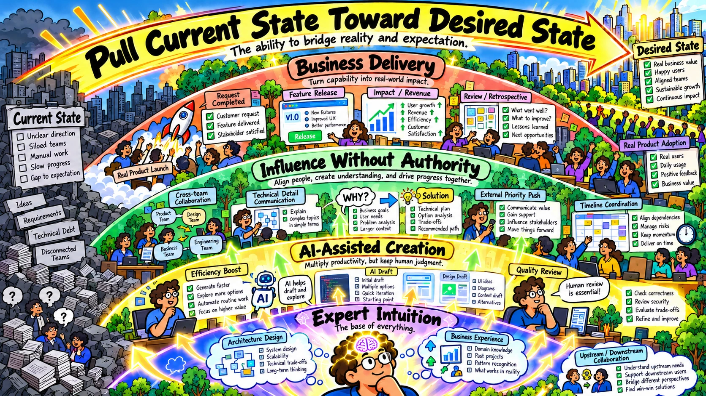

# [Development] AI 時代最需要的能力是專家直覺（Expert Intuition）

[English](./01-Development-AI-Era-Expert-Intuition.md) | [繁體中文](./01-Development-AI-時代最需要的能力是專家直覺.md)

我想使用 AI 的人會特別有感，AI 把大量重復勞動工作能更高效率的完成。甚至具有一定的推理性跟猜測性，可以幫人類完成一部分具備「創造和模仿」的工作。這也讓過去被認為「快速完成產出」的重要性降低，並讓真正能業務落實或者說完整的「把現況拉向期望」的軟實力重要性上升。

而我認為的軟實力基礎是「專家直覺」，原因是 AI 的產物最終都要進入人類的世界，為 AI 產出負責、購買意願、使用評價皆來自人類，所以 AI 當前更像是生產的過程的加速器而已，它加速讓能完整落實的軟實力被看見，後續我會以軟體工程來當例子，其他產業的朋友可以自行轉換對應。

### 專家直覺是什麼？

對於 專家直覺（Expert Intuition）這個詞陌生的人能移步以下查看學術的定義

1. [Conditions for intuitive expertise: A failure to disagree.](https://psycnet.apa.org/record/2009-13007-001)
2. [Dan Kahneman and Gary Klein on strategic decisions: When can you trust your gut?](https://bobmorris.biz/dan-kahneman-and-gary-klein-on-strategic-decisions-when-can-you-trust-your-gut)

本篇不會展開名詞學術討論，只會聚焦在真實的「軟體工程進入業務場景的專家直覺」初步說明，先看以下這張圖

AI Expert Intuition

要完成一項軟體開發並落實到業務場景，Coding 只是佔其中一部分而已 (圖中手電筒照亮的區域)，更完整的是需要有 架構設計、錯誤定位、方案取捨、上下游串接、發佈基準、版本控制、轉換分析 (圖中光亮以外的部分) 等各種商業需求所產生的長期演進、協作、Schedule、策略、評估、營利，更不用說對於業務灰色規則的理解，這些是目前 AI 無法完成的，但恰恰是軟體在人類世界的存在的收益來源。

### 我所認為的「專家直覺」

在軟體工程中所謂的專家直覺是能滿足「完整業務落實」的能力，我拆分為:

> ***軟體工程的專家直覺 = 架構設計 + 業務經驗***

#### 架構設計

現實的開發任務沒有標準答案，軟體開發會隨著 User 人數、目標群體、時間緊迫性、跨國際、地區、信仰文化等等來調整，所以真正的專家要能做到

1. **方案取捨**：說出架構設計的方案為什麼「選 A，而不選用 B、C、D、E」，是否有符合的設計模式，而不是半年後回來看時人類難以維護，只能被迫執行 ACA (AI Check AI) 的開發地獄。
2. **錯誤定位**：當 AI 在說出表面合理但錯誤的理解、Code 耦合冗餘，種種導致無法運行時你要能發現並解決，例如: 最經典的問題是「我這手機能正常跑啊，但為什麼別人的不能」，畢竟真實情況你不能把每個 User 的手機都拿過來給 AI 跑一次檢查，而且如果是線上問題修復時間會更緊迫，每多故障一分鐘就更多損失，AI 不會替損失負責，會要你本人負責。
3. **問題邊界**：現階段的 AI 處在一個你沒提到、你沒問，那 AI 預設就不會回答，除非它有非常高的關聯性，要出現在 Retriever 分析中的 Top K 才可能被提到，然而現實的 Bug 往往是由少數場景引發的，例如: 開發 WeChat Miniapp 的 Request Head 限長度要 <= 1024 Byte，當 Head 擴充超過該長度限制就 Request Fail，不知道這邊界問題的人純使用 AI 開發並且發布，將導致災難。
4. **問題定位**：真實的開發很常會需要 Performance 提升，那提升的手段到底是要放在哪個目標的 User 族群？哪一個指標？要針對老舊機型的 User 還是其他的族群，提升的 Performance TTFT / LCP / QPS 等等指標和業務的 DAU、MAU 有哪些關聯？如何下手才能提高轉換率。AI 現在做不到把這些東西很自然地連在一起。哪怕它給出數字，也只是一個局限甚至是隨意地的推測值。

#### 業務經驗

軟體進入業務領域變成開發任務，核心還是圍繞實際場景，特別是上下游串接、發布時間、搭配活動、歷史災難事件

1. **上下游串接**：成熟的大型 App 不只有一個團隊在開發，往往是多團隊開發，再者某個流程要完成會依賴數十個、甚至上百個 Key / Value，如何辨別當前開發的功能取用哪個 Value 能完成、哪個 Value 修改後自身團隊沒影響，但會引發上下游團隊的問題，因為每個團隊對於 Code 的管理都是有權限的，無法隨意被 外部 AI 讀取，哪怕對方給你權限，那它還有上下游呢？
2. **發布時間**：這個需求發布在真實世界是什麼場景？最簡單的，譬如說聖誕節、黑色星期五，能不能搭上真實世界人類行為的購買預期，來讓業務收益提升。
3. **歷史災難事件**：避免過去發生的相似修改導致災難，例如: 活動引流用戶數量遽增時不會 APP 崩潰、Server Overload、出現重複操作、重複訂單等問題、或是做為 Open Source 的提供方，你做了修改卻導致使用 Tool 的下游團隊災難，例如: 曾經發生的 [Ant-design 聖誕節彩蛋災難](https://github.com/ant-design/ant-design/issues/13848)。

### 專家直覺再精進：把現況拉向期望的能力

AI 時代真正稀缺的軟實力再往下精進，我拆分為:

> ***把現況拉向期望的能力 = 專家直覺 + 無權領導力***

#### 無權領導力

不管在職場或是Open Source 社區的協作會需要到大量溝通，並非每次都是有直接的指揮權，如何與外部的成員 討論方案 和 提高執行意願 這是也 AI 無法替人補足又真實存在的一環

1. **協作團隊的意願**：AI 時代人類的時間跟注意力是很稀缺的資源，上下游有他們團隊自己需求的 Priority 和任務 Schedule，哪怕 AI 可以快速完成 Code 的產出，但你也要讓對方願意使用時間來和你溝通，所以讓自己的需求排進到對方的 Schedule 當中，並且提高 Priority 讓對方的執行意願、配合度增加是很重要的事，因為 AI 無法幫你去說服你的同事。
2. **依賴成本的釐清**：沿著前述提到的多團協作場景下，會產生你的任務想要完成的話有依賴路徑，例如: 你的任務 ➔ 團隊 A ➔ 團隊 B ➔ 團隊 C，只要其中有一個環節延遲或出錯，將無法如期完成任務，考驗的正是你如何把多方協作的產物、契約都約定正確，並且讓各方都知道自己在哪個環節，如果進度落後影響會有多大，AI 當然無法幫你完成這方面的任務。

### 結論：專家直覺在 AI 時代比過去更重要

身處 AI 爆炸性增長的時代，人人都在問、都在思考如何降低 Token，降低成本、減少人類時間的消耗，但該適當地停下來反問有沒有一種能力是 不透過 AI、不燒 Token、不浪費等 AI 回復的時間，你就已經可以反應出真實業務場景的問題，並且在短時間內給出解決方案，不要浪費了所有成本之後才發現原來有問題存在、方向根本被 AI 帶偏了、受制於外部無法如期完工。

期望每個專業能力的工作者，同時具備三個能力：

1. 有精準使用 AI 的基礎能力
2. 有專家直覺來判斷 AI 的產出是否正確
3. 有把現況拉向期望的軟實力

以上 AI 時代最稀缺的能力，避免快速的用 AI 完成了表面產出，但這個產出沒辦法跟真實的需求相符，也不能被人類安心的使用，甚至出了問題，人類要修正還找不到切入點，最後變成只能 ACA (AI Check AI) 的惡性循環。
