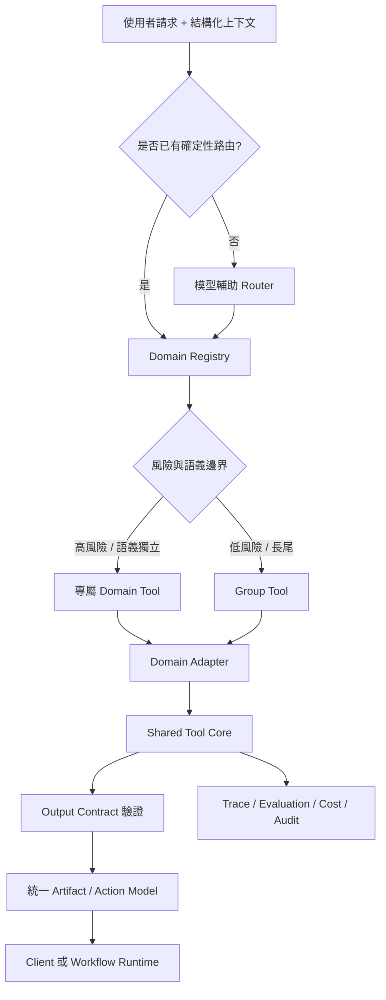

# Tool Schema 与 Registry-driven Routing

[](./README.md)
[](./README-zh-TW.md)
[](./README-zh-CN.md)

用来设计模型可见的 Tool Contract、在大量相似能力之间进行路由，并治理生产环境中的 Tool Calling 行为。

> 所有示例均为合成数据。这个 `模式` 不依赖特定通讯产品、交易平台或模型供应商。

## 问题本质

Tool Schema 会同时影响函数 JSON 参数与下列行为：

- 模型是否选中正确能力
- 模型是否以正确语义与格式抽取参数
- 相似 Domain 是否互相污染
- Runtime 是否能验证、授权、观测与回滚 Tool Call
- 最终 Artifact 或 Action 是否安全可靠

传统 DRY 原则仍然重要，但不能套错层。单一泛化 Tool 可能减少代码重复，却同时增加模型歧义与生产风险。

## 参考架构



## 核心原则

1. **语义分域、内核共享。** 模型可见边界保持明确，内部复用验证、埋点、Fallback 与渲染能力。
2. **结构化事实优先于推断。** 已由可信 Metadata 宣告的 Domain，不应再要求模型猜测。
3. **Router 分类，Domain Tool 执行。** Router 不应演化成第二套业务服务层。
4. **Router Contract 稳定，Registry 动态扩展。** 新增低风险 Domain 不应频繁改 Router Schema。
5. **高风险专属、低风险收敛。** 涉及资金、身份、资格、写入或不可逆操作的能力应拆分。
6. **输入与输出都是契约。** JSON Schema 约束参数，Runtime Output Validation 约束操作事实。
7. **评测属于设计的一部分。** Tool 选择、参数、跨域误调、Fallback、安全、延迟与成本都必须可测量。

## 合成参考 Domain

| Domain | 核心语义 | 典型风险 |
|---|---|---|
| Claimable Grant | 领取已配置或分配的资产 | 写入、库存、欺诈 |
| Redeemable Voucher | 在条件成立时核销价值 | 金额、资格、交易状态 |
| Membership Entitlement | 依身份或等级使用权益 | 身份、访问控制 |
| Policy-based Subsidy | 依政策、地区、品类判断资格 | 政策、合规、金额 |

这四类示例保留了语义隔离问题，但不依赖任何特定产品。

## 文件地图

1. [Tool Schema 设计](./docs/01-tool-schema-design-zh-TW.md)  
   模型可见契约、命名、description、参数、Output Contract、语义边界与 Token 取舍。
2. [Registry-driven Tool Routing](./docs/02-registry-driven-tool-routing-zh-TW.md)  
   路由瀑布、动态 Registry、候选 Tool 缩小、风险分组与扩展策略。
3. [Tool 治理、评测与可观测性](./docs/03-tool-governance-and-evaluation-zh-TW.md)  
   生命周期、Owner、版本、数据集、指标、灰度、回滚、授权与事故处理。

辅助资产：

- [设计模式](./patterns/README-zh-CN.md)
- [模板](./templates/README-zh-CN.md)

## 快速判断

出现以下任一条件时，优先使用专属 Tool：

- 操作会修改持久状态
- 涉及金额、身份、政策或资格
- Status Model 或 Action Vocabulary 有实质差异
- Service Owner、授权或回滚策略不同
- 调错 Tool 会产生不安全或误导性的操作

只有在以下条件全部成立时，才适合使用 Group Tool：

- 能力是只读或纯展示
- 字段语义相同，而非只是在 JSON Shape 上相同
- Output Contract 和 Fallback 策略等价
- 子类型判错不会造成财务、法务或不可逆影响

## 非目标

这个 `模式` 不是：

- 可直接上线的 Router 实现
- Server-side Authorization 的替代品
- 模型必定正确调用 Tool 的保证
- 把所有内部 API 暴露给模型的理由
- 把频繁变动的政策规则塞进 description 的做法
- OpenAI、Anthropic、LangChain、LangGraph 或 MCP 的专属方案

## 建议阅读顺序

```text
README
→ Tool Schema 設計
→ Registry-driven Tool Routing
→ 治理與評測
→ Patterns
→ Templates
```

## 来源说明

Schema 撰写原则参考
[Tool Schema 设计模式详解](https://developer.volcengine.com/articles/7622979721047277606)，
并在此基础上补充 Domain Boundary、Tool Routing、Output Contract、治理与生产评测设计。
