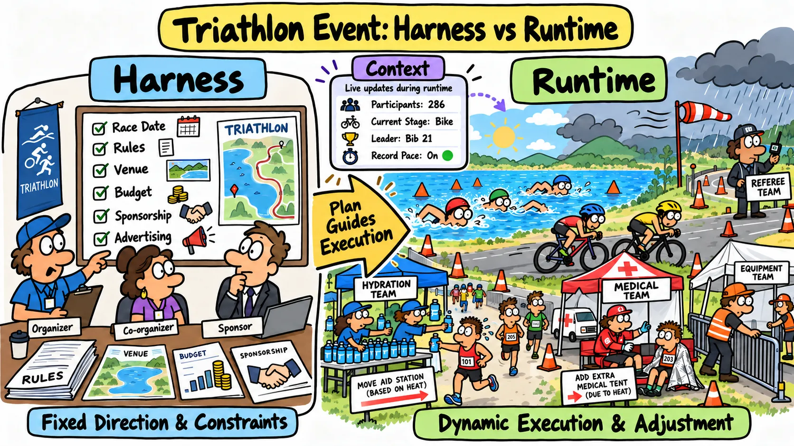
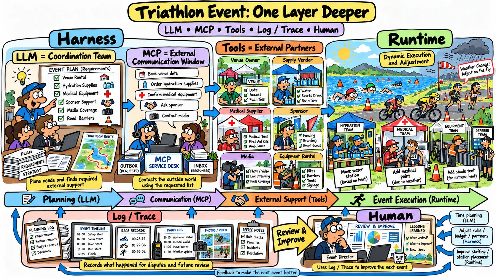
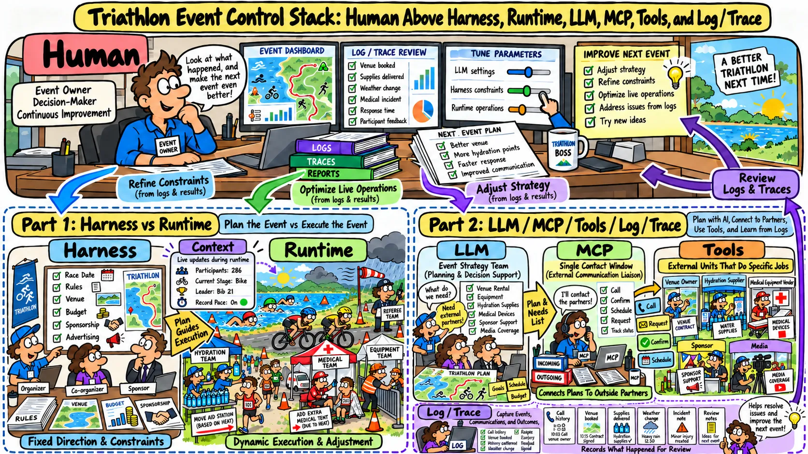

# [AI Agent] Without Technical Jargon Can You Clearly Explain Harness and Runtime?

[English](./01-AI-Harness-Runtime-Jargon-Free.md) | [繁體中文](./01-AI-Harness-Runtime-Jargon-Free.zh-TW.md) | [简体中文](./01-AI-Harness-Runtime-Jargon-Free.zh-CN.md)

First things first! Can you answer this question clearly? I wrote this because I found that many developers don't understand the different roles and tasks of Harness and Runtime, so they just fill in the blanks with a lot of technical terms.

> If you cannot answer clearly, or if parts of your answer feel vague, this knowledge base can help you distinguish between the two.

## My Answer: Think of a Race, Such as a Triathlon！

### Part 1: Harness and Runtime

  

- **Harness** = The event organizer

  It sets the overall direction of the race and handles tasks such as:
    - Setting the date
    - Defining the rules
    - Securing the venue
    - Raising funds
    - Finding sponsors

  These tasks set the direction and tend to remain fixed.

- **Runtime** = the equipment, aid station, and medical crews

  These crews keep the event running and adapt as conditions change during the race. Their responsibilities include:
    - Adjusting the number and location of aid stations based on the weather
    - Relocating medical stations
    - Adding or removing equipment tents

  The crews make these decisions during the race, so they must be able to adjust on the fly.

- **Context** = Information that changes as the race unfolds

  Because this information grows over time, scoreboards, media reports, and live broadcasts focus on the main points. examples of this changing information include:
    - Number of athletes competing
    - Current stage of the race
    - Current leader
    - Any records that have been broken

  AI Agents work the same way. When their context grows too long, it needs to be compressed into summaries and memory. In the race analogy, broadcasters have limited airtime, so they report only on the leading athletes instead of reading out every participant's name.

### Part 2: Other Agent Capabilities

  

- **LLM** = the race coordination team

  It plans the race and decides which outside partners the event needs. Its responsibilities include:
    - Deciding whether to bring in another equipment provider
    - Choosing who to rent the venue from
    - Determining how to obtain the necessary equipment
    - Deciding whether to seek support from sponsors and advertisers

- **MCP** = the single point of contact for outside partners

  It contacts outside partners based on the list prepared by the coordination team. Its responsibilities include:
    - Contacting the venue owner
    - Confirming rental dates
    - Notifying race supply vendors
    - Contacting medical equipment vendors

- **Tool** = an outside partner

  Each Tool represents one of the outside partners named on the race checklist. Examples include:
    - Race supply vendors
    - Sponsors
    - Media outlets covering the event

- **Log / Trace** = records of the race

  These records help organizers review disputes and improve the next event. Sources of these records include:
    - Referees
    - Photographers
    - Timing systems

### Part 3: What Humans Are Responsible For

  

- **Human** = the owner of the event organization

  The Human uses Log / Trace to observe and control the teams involved so that the next race can run better. This includes overseeing:
    - Coordination team (LLM)
    - Event organizer (Harness)
    - Equipment, aid station, and medical crews (Runtime)
    - Information generated during the race (Context)
    - Outside partners (Tool)

  The Human can also:
    - Replace the coordination team (Change Model)
    - Run a different type of race (Change Business)

**Putting the analogy together**

> Runtime operates within the boundaries set by the Harness and adapts as needed. Context is the information being processed, while Tools provide additional capabilities.
> Humans use Harness and Runtime to control LLMs and Agents so they can meet the operational needs of different businesses.
