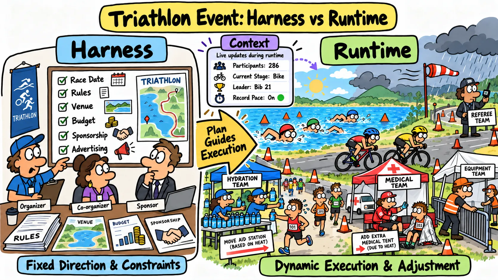
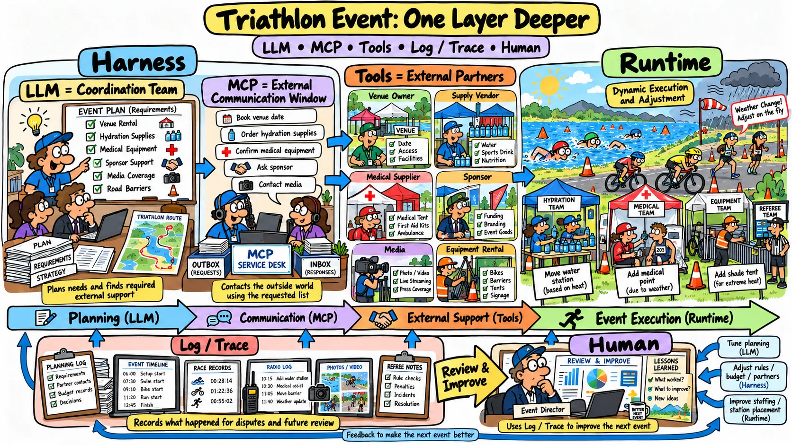
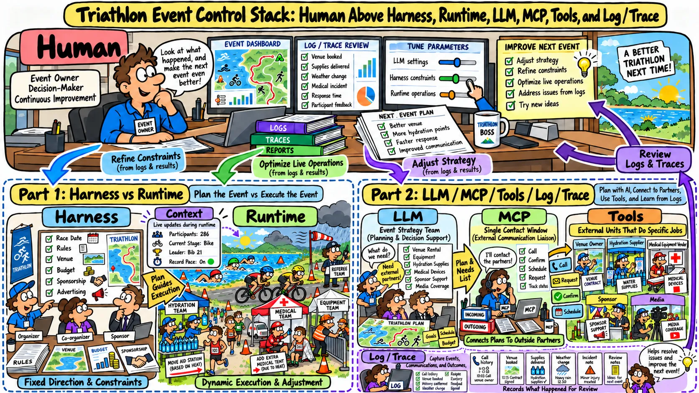

# [AI Agent] 不用技术名词，你能说清楚 Harness 和 Runtime 是什么吗？

> 如果你一时答不上来，或者觉得两者的区别还有点模糊，这个仓库可以帮你分清楚。

## 我用一场铁人三项比赛来回答

### Part 1 · Harness 和 Runtime

  

- **Harness** = 主办方，负责定下赛事的整体安排。
    - 比如确定比赛日期、制定规则、借用场地、筹措经费、找赞助商。这些事决定了赛事的大方向，定下来以后通常比较固定。

- **Runtime** = 设备组、补给组、医疗组等在比赛现场干活的团队。比赛进行时，他们会根据现场情况灵活调整。
    - 比如遇到天气变化，就调整补给点的数量和位置、医疗组的站点，或者设备组的帐篷。这些安排可以在比赛进行中临时增减或挪动。

- **Context** = 比赛进行中不断更新的信息。随着比赛推进，信息越积越多，记分表、媒体报道和赛事转播都会挑重点来呈现。
    - 比如有多少人参赛、现在比到哪个项目、谁暂时领先、有没有人打破纪录。

  AI Agent 也是这个道理。上下文太长时，需要把内容压缩成摘要，做法和记忆有些相似。就像播报时间有限，解说员会介绍排在前几位的选手，省去逐一念出所有参赛者姓名的时间。

### Part 2 · Agent 的其他能力

  

- **LLM** = 主办方里负责统筹这场比赛的团队，负责拟定方案，弄清楚需要哪些外部单位协助。
    - 比如比赛设备要不要找外部单位协助、场地找谁租、设备从哪里来、是否需要广告商赞助。

- **MCP** = 主办方统一对外的联络窗口，拿到统筹团队列出的需求清单后，按清单联系外部合作单位。
    - 比如联系场地所有者、敲定租用日期、联系供应商采购补给品、找能提供医疗设备的厂商。

- **Tool** = 比赛清单上列出的各个外部合作单位。
    - 比如补给品供应商、赞助商、前来采访的媒体。

- **Log / Trace** = 比赛举办过程中的记录，可以用来复盘比赛中的争议，也能为下次办赛提供参考。
    - 比如裁判的记录、摄影师拍下的画面、计时器记录的时间。

### Part 3 · 人负责什么

  

- **Human** = 主办方的老板。老板通过 Log / Trace 了解比赛是怎么运转的，再决定哪些安排需要调整，让下次比赛办得更好。
    - 查看并调整统筹团队(LLM)、主办方(Harness)、设备组／补给组／医疗组(Runtime)和比赛过程中的信息(Context)
    - 管理外部合作单位(Tool)
    - 换一个统筹团队(Change Model)
    - 改办另一种比赛(Change Business)

> 说白了，Runtime 在 Harness 划定的范围内做事，遇到变化就现场调整。Context 是比赛进行中的信息，Tool 提供额外的能力。
> 人通过 Harness 和 Runtime 来管理 LLM 和 Agent，以满足不同的业务需求。
