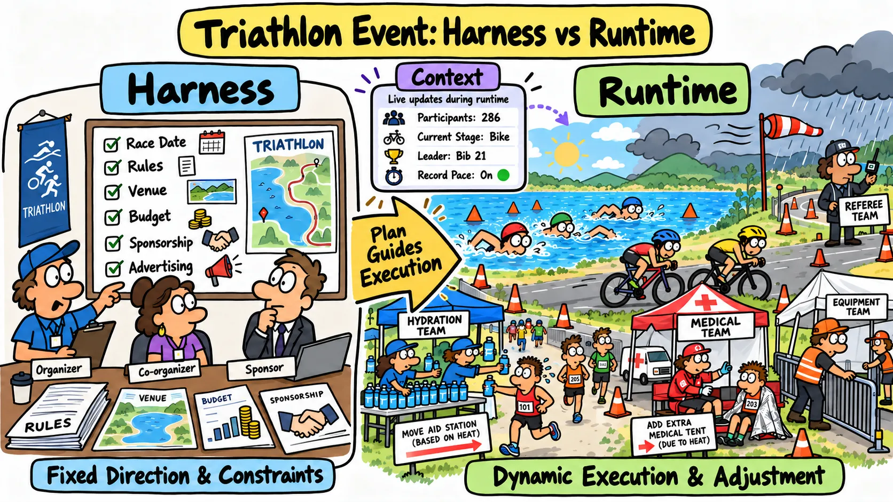
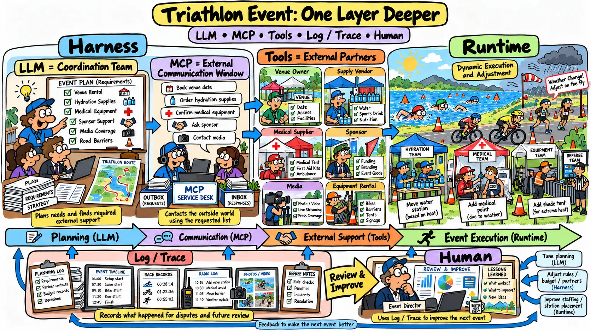
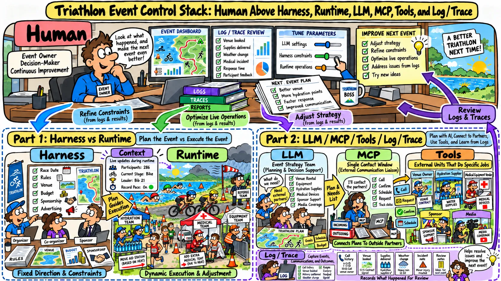

# [AI Agent] 不用技術名詞，你能說清楚 Harness 跟 Runtime 是什麼嗎?

[English](./01-AI-Harness-Runtime-Jargon-Free.md) | [繁體中文](./01-AI-Harness-Runtime-Jargon-Free.zh-TW.md) | [简体中文](./01-AI-Harness-Runtime-Jargon-Free.zh-CN.md)

> 如果你回答不出來或答案有模糊點，這個庫可以幫助你更清晰的區分兩者

## 讓我來回答: 我會用比賽來舉例，例如: 一場鐵人三項的比賽

### Part1: Harness 跟 Runtime

  

- **Harness** = 主辦單位負責規劃賽事大方向的角色
    - 例如: 舉辦日期 / 比賽規則 / 籌借場地 / 資金 / 找贊助 等等有方向性且趨於固定的任務

- **Runtime** = 設備組 / 補給組 / 醫療組 等等是在比賽進行時，真正動態工作、靈活調整的角色
    - 例如: 比賽進行時，依照天氣會調整補給點的多寡和位置 / 醫療組的站點 / 設備組的帳篷 等等這些都是進行時，靈活增刪跟機動的

- **Context** = 比賽進行中不斷更新的內容，因為內容隨著時間一直再更新與增加，所以計分表 / 媒體報導 / 賽況轉播 只會抓重點來說明
    - 例如: 多少人參賽 / 目前進行到哪個項目 / 當下誰領先 / 是否有破紀錄 等等

  AI Agent 也相同道理，一旦上下文太長就需要壓縮摘要跟記憶相似，對比起來就是在有限的播報時間內，只會報導前幾名領先的選手資訊而不會把全部參賽者的姓名都念一遍

### Part2: 其餘 Agent 能力

  

- **LLM** = 賽事主辦單位中，擔任本次比賽統籌的團隊，負責規劃構想，找出需要哪些協力外部單位的角色
    - 例如: 比賽設備是否要找額外協力單位 / 場地跟誰租借 / 設備怎麼獲取 / 是否贊助廣告商支持

- **MCP** =  主辦單位中統一對外的溝通窗口，負責按照統籌團隊給出的所需清單聯繫外部的協力單位
    - 例如: 聯繫場地所有者 / 訂好租借日期 / 通知採購補給品廠商 / 聯繫提供醫療設備廠商

- **Tool** = 比賽清單上寫的每個外部協力單位
    - 例如: 補給品廠商 / 贊助商 / 採訪媒體

- **Log / Trace** = 比賽舉辦過程的紀錄，用來檢討比賽爭議或改進下一次比賽舉行的材料
    - 例如: 裁判 / 攝影師 / 計時器

### Part3: 人類負責的範圍

  

- **Human** = 主辦單位的老闆，透過 Log / Trace 來觀測跟控制以下角色，讓下次比賽舉辦的更好。
    - 統籌團隊(LLM) + 主辦單位 (Harness) + 設備組/補給組/醫療組 (Runtime) + 比賽過程內容 (Context)
    - 協力單位(Tool)
    - 替換新的統籌團隊(Change Model)
    - 執行別種類型的比賽(Change Business)

> 所以用白話來說可以理解為 Runtime 是在 Harness 的規劃好的範圍內運行 + 靈活調整的角色，而 Context 是內容，Tool 是額外能力
> 而人類使用 Harness + Runtime 來控制 LLM 和 Agent 滿足不同的 Business 的操作
