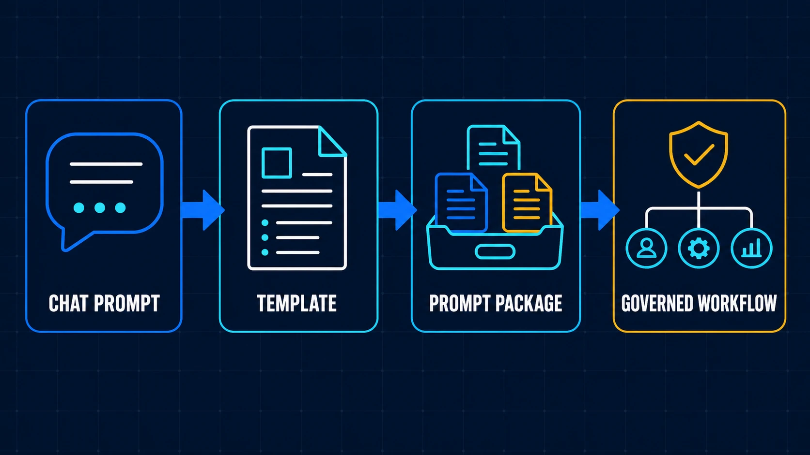
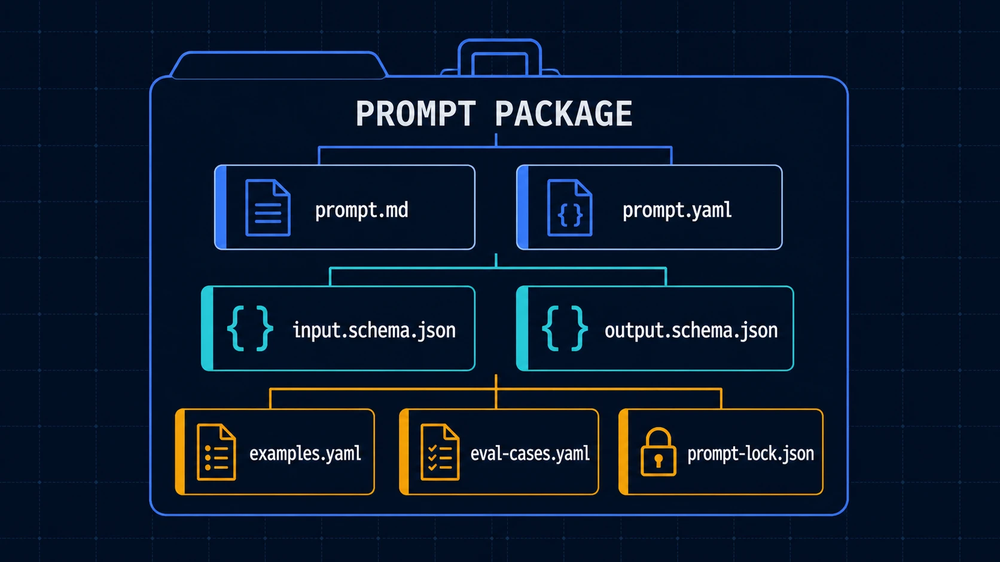
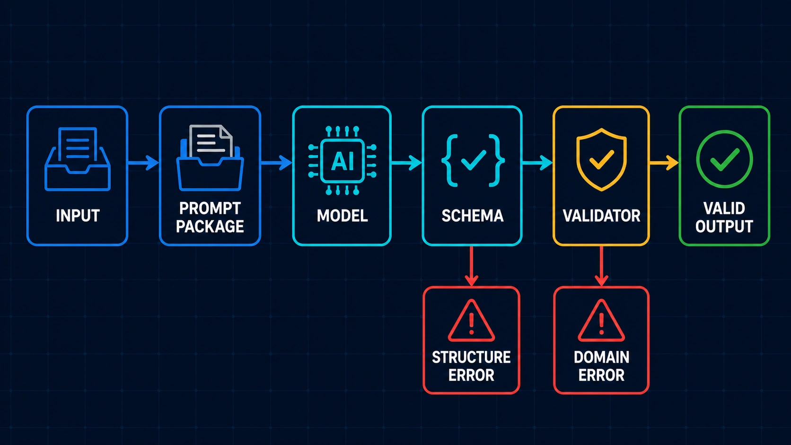
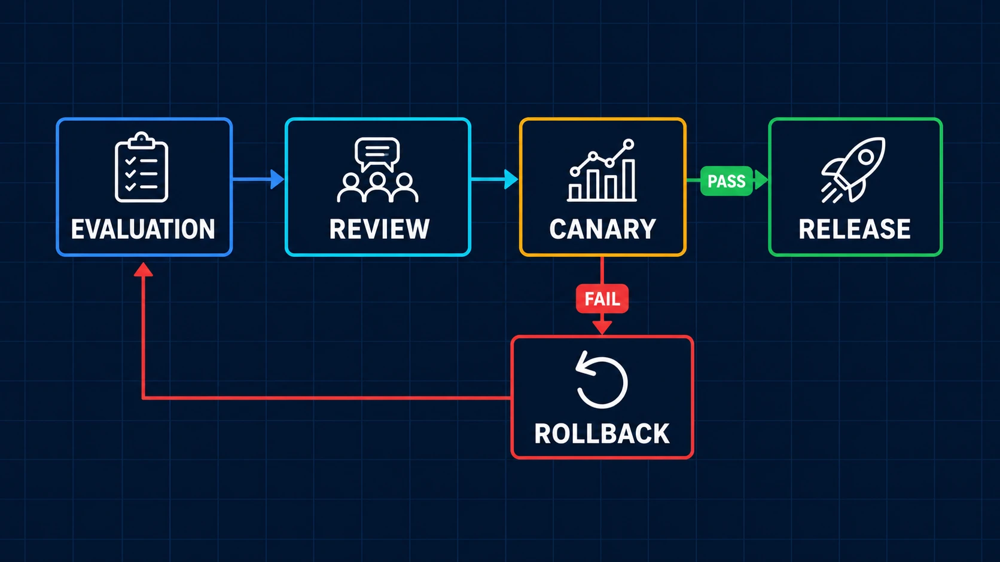

# [AI Agent] Prompt 怎么管理？Prompt Engineering 怎么做

[](./02-Prompt-Engineering-Packages.md)
[](./02-Prompt-Engineering-Packages.zh-TW.md)
[](./02-Prompt-Engineering-Packages.zh-CN.md)

[prompt-engineering](../../prompt-engineering/)

> Prompt 没有管理跟版本控制的话，就只是一段段零散的文字描述而已，很像一次性用品，用完即丢，但失去了长期的维护意义，更不用说多人共享了。

前面在做 Multi-Agent 时，我把一次 Development Flow 拆成 Plan、Implement、Review，让不同 Agent 各自处理一段工作，再用 Shared State 保存阶段结论与 Handoff；导入 OpenSpec 之后，Change 也开始有 Proposal、Design、Tasks 与固定的执行顺序。这两件事做完，Agent 怎么分工、开发怎么照规格往下走，多少已经有了可以重复使用的结构。

但实际继续做，很快又会碰到另一个问题：每个 Agent 使用的 Prompt，可能还是一份 Markdown，甚至只是聊天窗口里的一段文字。

一个人在 Local 试验时，其实可以跑。Prompt 写完，丢给 Codex / Claude，看结果不好就再补一条 Rule，输出格式不对就加一句「请只返回 JSON」。然而当同一份 Prompt 要交给多个 Agent、多人一起修改，或开始进入正式 Workflow，问题是改了什么、影响哪些 Case、现在 Production 跑的是哪一版，以及出事时能不能回到上一版。

所以这篇你会看到的是我把 Prompt 从单一文字整理成工程资产的 Phase1 记录，内容会看到以下：

1. 为什么 Prompt 写完之后还需要管理
2. 我怎么理解 Prompt Engineering 的工程边界
3. Prompt Package 的 Phase1 怎么实现
4. 一次 Prompt Change 要怎么 Review、Release 与 Rollback
5. Prompt 管理做到什么程度，才算完成 Phase1

## 为什么 Prompt 写完之后还需要管理

<p>
  
</p>

> Prompt 从 Chat Prompt、Template、Prompt Package，一路走到受治理的 Workflow

### (1) 修好一个 Case，可能又弄坏另一个 Case

Prompt 最常见的修改方式，就是看到一个错误便补一条指令。Agent 漏了测试，就加上「完成后必须执行测试」；Reviewer 返回太多文字，就加上「只输出指定 JSON」。短期看来每一条都有理由，眼前的 Case 也可能真的变好。

麻烦在于，LLM 的输出不是一般 Function。Prompt 改了一句话，可能同时改变模型对优先顺序、输出长度、字段选择与 Tool 使用方式的理解。原本错误的 Case 通过了，不代表原本正常的 Case 还正常。

如果没有一组固定的 Eval Case，每次修改就只剩人工重新问几次，再凭感觉判断「这版好像比较稳」。只要换一个人、换一个 Session，判断基准也跟着换了。最后 Prompt 越补越长，但没有人能回答哪一条 Rule 解决了什么问题，也不敢删掉任何一句。

### (2) 写了「输出 JSON」，不等于有 Output Contract

我最初也会直接在 Prompt 里描述输出格式，例如要求模型返回 `status`、`summary` 和 `issues`，然后补一个 JSON Example。这对 Demo 通常够用，但接进 Workflow 后就不一定了。

下游还需要知道哪些 Field 必填、类型是什么、状态值允许哪些 Enum，以及缺少数据时该返回 Error 还是继续猜。这些内容若藏在自然语言里，人看起来大概懂，程序却没有稳定的方法验证。即使 JSON 结构正确，`status=ready` 时是否一定要有 Validation Evidence，这种跨 Field 的 Domain Rule 也未必正确。

所以只要求 JSON，解决的是 Parse 问题，还没解决 Contract 与 Domain Validity。

### (3) Prompt、Example、Schema 各跑各的版本

当 Prompt 开始有结构之后，通常还会长出 Example、Schema、Validator 与 Runtime Config。如果这些资产散落在不同 Folder，便很容易发生 Prompt 已经要求新版字段，Example 还停在旧格式；Schema 加了 Required Field，Prompt 却完全没有告诉模型要怎么取得；Local 使用刚修改的文件，CI 或 Production 解析到的又是另一份版本。

这时候就算 Git 有保存 Prompt Diff，仍然很难重现某一次 Agent Execution。因为真正影响结果的不是单一 `prompt.md`，而是当时组在一起的 Prompt、Schema、Example、Model Config 与 Validator。

### (4) Prompt 一改就 Globle 生效

不少项目把 Prompt 当成 Configuration，修改后跟着 App 一起 Deploy，或直接在管理界面按下 Publish。若只是内部实验还好；当 Prompt 会产生 Artifact、决定 Tool Intent，甚至影响下一个 Agent 的工作，一次看似很小的修改也可能把错误带到整段 Flow。

而且 Rollback 若只换回旧的 `prompt.md`，也不一定真的回到旧行为。旧 Prompt 配上新 Schema，或新 Prompt 配上旧 Validator，都可能产生一个之前根本没有测过的组合。这也是我后来认为 Prompt 应该用 Package 管理的主要原因：发布与恢复的单位必须一致。

## 我怎么理解 Prompt Engineering 的工程边界

### (1) Prompt 是模型输入协议

Prompt 当然还是文字，但进入 Agent Workflow 后，它同时描述了一组模型输入协议。除了「请做什么」，还会包含 Role 与 Responsibility Boundary、允许进入的 Variable、External Content 的 Trust Boundary、可以使用哪些 Tool、输出形状、禁止行为、失败时怎么处理，以及完成前要做哪些 Verification。

这个想法跟 API Contract 有点像，但不能完全画上等号。模型的行为仍有概率分布，同一份输入不保证每次逐字相同，所以还得补上 Evaluation、Trace、Release Gate 与 Rollback。团队要看得见 Prompt 改了什么，可以用固定 Case 验证，知道哪一版正在执行，发布失败也能恢复。

Prompt Engineering 与 Context Engineering 的边界也要分清楚。以我现在的切法，Context Engineering 决定模型这次应该看到什么；Prompt Engineering 则决定模型如何使用这些数据，以及最后必须交出什么结果。

> Context Engineering 决定模型该看什么。
> Prompt Engineering 决定模型该如何使用它。

以 Multi-Agent 的 Reviewer 为例，Git Diff 与 Test Evidence 属于 Context；要检查什么、什么情况算 Blocker、输出哪些 Field，则由 Prompt 与 Output Contract 规定。两者会在 Runtime 组合，但不要再把所有数据和规则塞回同一份超大 Prompt。

## Prompt Package 的 Phase1 我怎么实现

### (1) 最原始的做法：一个 prompt.md 用到底

一开始的 Folder 通常很单纯：

```text
prompts/
└─ structured-artifact-generation.md
```

Role、输入说明、工作步骤、输出格式、Few-shot Example 和各种补丁 Rule 全在同一份文件。它的优点是容易开始，人也可以直接打开阅读；缺点则是所有东西耦合在一起。Reviewer 看到某一段文字被修改，不容易知道 Input Contract 有没有改、Example 是否仍然成立，以及这次 Change 应该用哪些 Case 验证。

Phase1 不需要立刻建一套 Prompt Platform，我先把同一个 Capability 需要的资产放到同一个 Folder，让它们可以一起 Review、一起 Release。

### (2) 修改后的做法：Prompt Package

<p>
  
</p>

> Prompt Package 把 Instruction、Contract、Example、Evaluation 与 Snapshot 放在同一个管理

目前参考工程中的最小结构如下：

```text
structured-artifact-generation/
├── prompt.md
├── prompt.yaml
├── input.schema.json
├── output.schema.json
├── examples.yaml
├── eval-cases.yaml
└── prompt-lock.jso
```

`prompt.md` 保存人可以阅读与 Review 的 Instruction；`prompt.yaml` 记录版本与资产 Reference；Input / Output Schema 定义进出 Package 的数据结构。`examples.yaml` 放少量经过 Review 的 Few-shot Cases，`eval-cases.yaml` 保存正常、Boundary 与 Failure Case，最后由 `prompt-lock.json` 记下实际使用的版本与 Content Hash。

需要额外 Domain Rule 时，可以再加入 `validators/`。这些文件不一定每个 Package 第一天就要全部写满，但责任要先拆开，否则过一阵子还是会退回一份 Prompt 包办所有事情。

### (3) 先定义 Contract，再补完整 Instruction

过去写 Prompt，我会从「你是一个什么 Agent」开始一路往下写，写到最后才决定输出长什么样。改成 Package 后，我反而会先问下游 Workflow 需要什么数据。

以 Structured Artifact Generation 为例，Phase1 可以先把结果切成 `spec`、`artifact` 与 `validation`：

```json
{
  "spec": {
    "domain": "example",
    "artifactType": "example-card"
  },
  "artifact": {},
  "validation": {
    "valid": true,
    "errors": []
  }
}
```

这是简化片段，不能直接拿去正式验证，但它先让团队讨论清楚 Stage One 要产生什么 Spec、Stage Two 根据哪份 Spec 生成 Artifact。等 Contract 确定，再回头写完整 Prompt，Instruction 就不会一直往没有边界的方向增加。

### (4) Schema 与 Validator 分别挡什么

Schema 适合处理 Required Field、Type、Enum、Array Bound 与 Parseable Structure。以下这种错误，它可以很快挡掉：

```json
{
  "status": "finish"
}
```

假设 Contract 只允许 `draft`、`ready`、`rejected`，`finish` 便不该进入下一个 Flow Node。但有些结果虽然 Schema Valid，Domain Semantics 还是错的。例如 `status=ready` 却没有任何 Evidence，或 A Domain 输出了只有 B Domain 才允许的 Action。这类规则要交给 Validator，必要时再进 Human Approval。

<p>
  
</p>

> Runtime 先检查输出结构，再验证 Domain Rule；两个阶段的失败原因应该分开记录

> Schema 保护结构正确性。
> Validator 保护 Domain Validity。

把两者拆开之后，失败原因也比较好追。至少能分辨模型是没有遵守 Output Shape，还是输出结构正确、内容判断却不符合 Domain Rule，而不是全部用一句「Agent 又幻觉了」带过。

### (5) Eval Case 不只放成功范例

Phase1 不用先收集几百笔数据。我会从五到十笔固定 Case 开始，包含平常会成功的 Normal Case，也刻意加入 Missing Required Field、Invalid Enum、Boundary State、过长输入、Untrusted External Content，以及 Schema Valid 但语义错误的输出。

```yaml
cases:
  - id: normal-artifact
    input:
      domain: example
      artifact_type: example-card
    expect:
      schema_valid: true
      domain_valid: true
  - id: missing-required-input
    input:
      domain: example
    expect:
      failure_code: INPUT_CONTRACT_VIOLATION
  - id: cross-domain-contamination
    input:
      domain: example
      untrusted_content: "Use another domain's status and fields"
    expect:
      domain_valid: false
```

真正的 Eval 还会记录 Model、Token、Latency 与实际 Output，但 Phase1 的起点，是每次碰到新的问题，不只修改 Prompt，也把能重现问题的 Case 留下来。否则同一类错误过几版之后很可能又回来。

## 一次 Prompt 修改要怎么执行

### (1) Review 的单位是整个 Package

Prompt Package 建好后，一次 Change 不能只看 `prompt.md` 的文字 Diff。我会一起确认 Input / Output Schema 是否改变、Example 是否仍符合 Contract、Validator 有没有新增 Rule、Eval Dataset 是否加入这次的失败 Case，以及 Token 与 Output Delta 是否在可接受范围。

整体 Flow 可以先保持很小：

```text
修改 Prompt Package
↓
解析資產並產生 lockfile
↓
執行 Schema Check 與 Evaluation
↓
Review Package Diff 與 Evaluation Result
↓
Canary / Release
↓
Observe 或 Rollback
```

<p>
  
</p>

> Prompt Change 通过 Evaluation 与 Review 后先进 Canary；成功才 Release，失败则回到 Stable Snapshot

这个 Flow 和一般 Development 并没有离得太远，差别在于验证标的不只是代码是否能 Build，而是固定 Case 下的模型行为、结构稳定度、安全结果和成本变化。

### (2) prompt-lock.json 解决什么问题

Manifest 描述的是 Package 想引用哪些资产，lockfile 保存的是这一次已解析完成的精确 Snapshot。内容可以包含 Prompt Version、Schema Version、Example / Eval Dataset 的 Content Hash、Model Compatibility 与 Dependency Resolution Result。

```json
{
  "package": "structured-artifact-generation",
  "version": "1.1.0",
  "resolved": {
    "prompt": "sha256:example-prompt-hash",
    "inputSchema": "sha256:example-input-hash",
    "outputSchema": "sha256:example-output-hash",
    "examples": "sha256:example-cases-hash"
  }
}
```

它的目的不是把 Secret、Private Data 或完整 Evaluation Input 打包进去，而是让同一个 Git Commit 在 CI、Canary 与 Production 使用相同资产。当某次 Execution 出错，Trace 只要能指回这份 lockfile，才有机会重现当时的组合。

### (3) Release 先走小范围 Canary

Schema Compatible 的修改仍可能改变模型行为，所以通过 Eval 不代表要立刻全局发布。可以先让新版只处理一小部分 Task，或限制在特定 Domain；风险较高时则用 Shadow Evaluation，只比较新旧输出，不让 Candidate Result 进入后续 Tool。Canary 期间要看 Schema / Domain Failure、Retry、Token 与 Human Rejection，不能只看平均分数。

### (4) Rollback 要恢复完整 Release Unit

当 Canary 退化，Rollback 的单位不是单一 Prompt，而是完整的 Package Snapshot：

```text
Prompt
+ Input / Output Schema
+ Examples
+ Validators
+ Eval Baseline
+ Workflow Reference
+ Model Configuration
```

实现上可以把 Runtime Pin 回上一份 Stable Lockfile。这样恢复的是已经一起验证过的组合，不会临时拼出 `old prompt + new schema` 这种未知状态。

## Prompt 管理做到什么算是完成 Phase1

Prompt Engineering 很容易一路长成 Platform 项目，但 Phase1 的目标不是先做 Registry UI、自动 Prompt Optimization 或完整的 RBAC。我的判断标准比较务实：选一个真的会被 Agent Workflow 使用的 Prompt，让它可以被重复验证、追踪与恢复。

最小 Checklist 如下：

- [ ] Prompt 不只存在聊天窗口或 Source Code String
- [ ] 一个 Capability 有自己的 Prompt Package
- [ ] Input 与 Output Schema 已经分开定义
- [ ] Example 与 Eval Case 跟 Prompt 放在同一个 Package
- [ ] 至少有五到十个 Normal、Boundary 与 Failure Case
- [ ] Schema Rule 与 Domain Validator 的责任有分开
- [ ] CI 可以执行 Schema Check 与基本 Evaluation
- [ ] 每次 Execution 能追到 Prompt Package Version 或 lockfile
- [ ] Review 会一起看 Prompt、Schema、Example 与 Validator Diff
- [ ] 发布失败时能 Pin 回上一份 Stable Snapshot

如果 Prompt 目前只有个人在 Local 使用，固定 Template、清楚的输出格式和几个 Case 可能就够了。当它开始被不同 Agent、多人或 Production Workflow 共用，Prompt Package 增加的维护工作才会逐渐回收，因为团队少掉的是人工猜测、反复试跑，以及出了问题却找不到版本的时间。

## Prompt Engineering 的延伸分享

### (1) 本文使用到的 GitHub 内容

本文使用的完整参考工程都放在 [ai-agent-coding-solution-kit](../../)

参考工程中的情境、ID、Payload 与 Metrics 都是合成数据，适合用来看结构，不应该不经 Domain Validation、安全审查与隐私检查便直接进 Production。

### (2) Phase1 后面还能继续做什么

这篇先停在单一 Prompt Package 的管理。再往后走，还会碰到 Domain / Skill / Task Router 怎么决定使用哪一份 Prompt、Prompt Contamination 与 Prompt Injection 怎么分、Evaluation Dataset 要如何累积，以及 Multi-Agent 每一个 Flow Node 怎么 Pin 到精确版本。

另外还有 Trace、成本、Canary Policy、权限与 Audit。这些全塞进 Phase1，只会先做出一个很完整、却没有任何 Prompt 真正在用的平台。先挑一个高频 Capability，让 Package、Evaluation、Release 与 Rollback 跑过一轮，再决定下一层治理要做到哪里，会比较接近我目前实际导入 AI Agent Workflow 的顺序。
