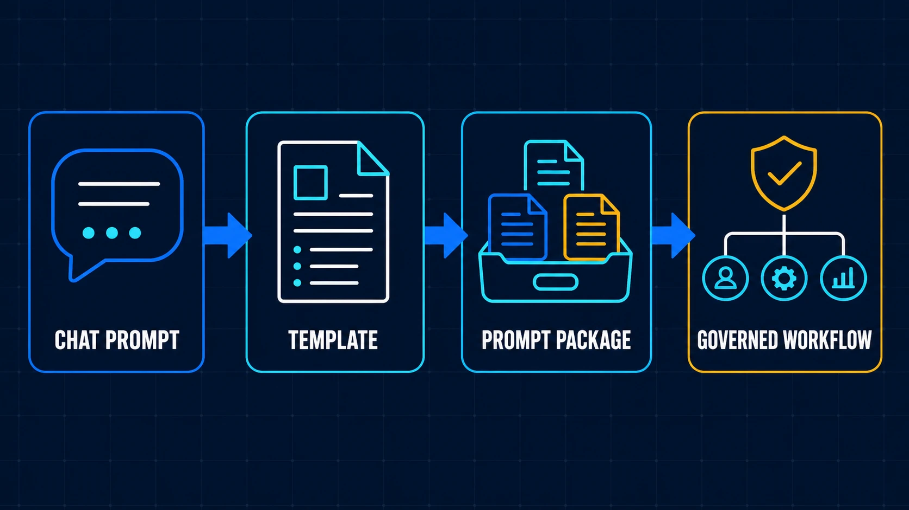
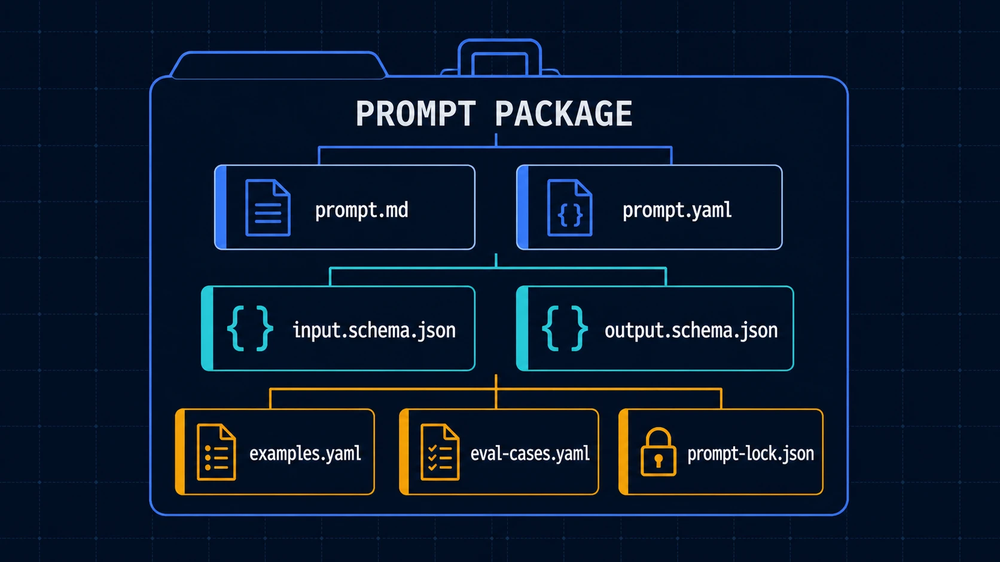
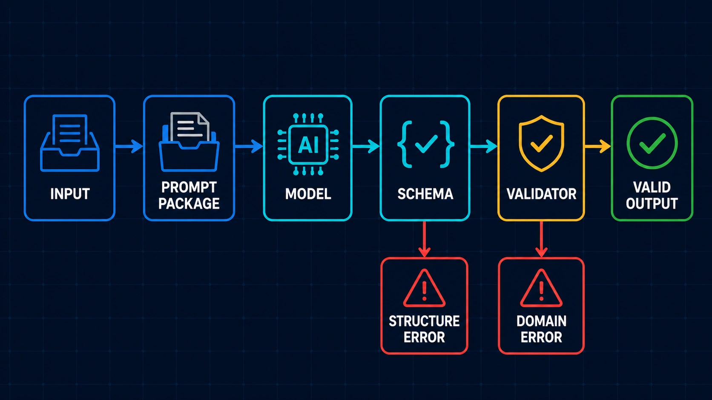
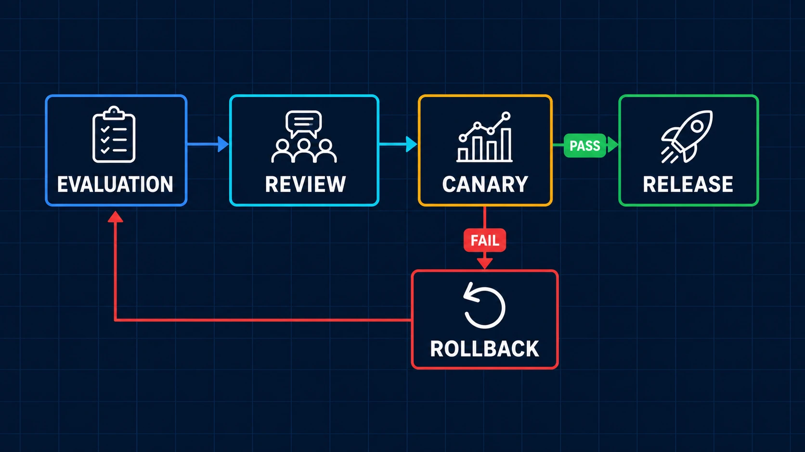

# [AI Agent] Prompt 怎麼管理？Prompt Engineering 怎麼做

[](./02-Prompt-Engineering-Packages.md)
[](./02-Prompt-Engineering-Packages.zh-TW.md)
[](./02-Prompt-Engineering-Packages.zh-CN.md)

[prompt-engineering](../../prompt-engineering/)

> Prompt 沒有管理跟版本控制的話，就只是一段段零散的文字描述而已，很免洗用完即丟，但失去了長期的維護意義，更不用說多人共享了。

前面在做 Multi-Agent 時，我把一次 Development Flow 拆成 Plan、Implement、Review，讓不同 Agent 各自處理一段工作，再用 Shared State 保存階段結論與 Handoff；導入 OpenSpec 之後，Change 也開始有 Proposal、Design、Tasks 與固定的執行順序。這兩件事做完，Agent 怎麼分工、開發怎麼照規格往下走，多少已經有了可以重複使用的結構。

但實際繼續做，很快又會碰到另一個問題：每個 Agent 使用的 Prompt，可能還是一份 Markdown，甚至只是聊天視窗裡的一段文字。

一個人在 Local 試驗時，其實可以跑。Prompt 寫完，丟給 Codex / Claude，看結果不好就再補一條 Rule，輸出格式不對就加一句「請只回傳 JSON」。然而當同一份 Prompt 要交給多個 Agent、多人一起修改，或開始進入正式 Workflow，問題是改了什麼、影響哪些 Case、現在 Production 跑的是哪一版，以及出事時能不能回到上一版。

所以這篇你會看到的是我把 Prompt 從單一文字整理成工程資產的 Phase1 紀錄，內容會看到以下：

1. 為什麼 Prompt 寫完之後還需要管理
2. 我怎麼理解 Prompt Engineering 的工程邊界
3. Prompt Package 的 Phase1 怎麼實作
4. 一次 Prompt Change 要怎麼 Review、Release 與 Rollback
5. Prompt 管理做到什麼程度，才算完成 Phase1

## 為什麼 Prompt 寫完之後還需要管理

<p>
  
</p>

> Prompt 從 Chat Prompt、Template、Prompt Package，一路走到受治理的 Workflow

### (1) 修好一個 Case，可能又弄壞另一個 Case

Prompt 最常見的修改方式，就是看到一個錯誤便補一條指令。Agent 漏了測試，就加上「完成後必須執行測試」；Reviewer 回傳太多文字，就加上「只輸出指定 JSON」。短期看來每一條都有理由，眼前的 Case 也可能真的變好。

麻煩在於，LLM 的輸出不是一般 Function。Prompt 改了一句話，可能同時改變模型對優先順序、輸出長度、欄位選擇與 Tool 使用方式的理解。原本錯誤的 Case 通過了，不代表原本正常的 Case 還正常。

如果沒有一組固定的 Eval Case，每次修改就只剩人工重新問幾次，再憑感覺判斷「這版好像比較穩」。只要換一個人、換一個 Session，判斷基準也跟著換了。最後 Prompt 越補越長，但沒有人能回答哪一條 Rule 解決了什麼問題，也不敢刪掉任何一句。

### (2) 寫了「輸出 JSON」，不等於有 Output Contract

我最初也會直接在 Prompt 裡描述輸出格式，例如要求模型回傳 `status`、`summary` 和 `issues`，然後補一個 JSON Example。這對 Demo 通常夠用，但接進 Workflow 後就不一定了。

下游還需要知道哪些 Field 必填、型別是什麼、狀態值允許哪些 Enum，以及缺少資料時該回傳 Error 還是繼續猜。這些內容若藏在自然語言裡，人看起來大概懂，程式卻沒有穩定的方法驗證。即使 JSON 結構正確，`status=ready` 時是否一定要有 Validation Evidence，這種跨 Field 的 Domain Rule 也未必正確。

所以只要求 JSON，解決的是 Parse 問題，還沒解決 Contract 與 Domain Validity。

### (3) Prompt、Example、Schema 各跑各的版本

當 Prompt 開始有結構之後，通常還會長出 Example、Schema、Validator 與 Runtime Config。如果這些資產散落在不同 Folder，便很容易發生 Prompt 已經要求新版欄位，Example 還停在舊格式；Schema 加了 Required Field，Prompt 卻完全沒有告訴模型要怎麼取得；Local 使用剛修改的檔案，CI 或 Production 解析到的又是另一份版本。

這時候就算 Git 有保存 Prompt Diff，仍然很難重現某一次 Agent Execution。因為真正影響結果的不是單一 `prompt.md`，而是當時組在一起的 Prompt、Schema、Example、Model Config 與 Validator。

### (4) Prompt 一改就 Globle 生效

不少專案把 Prompt 當成 Configuration，修改後跟著 App 一起 Deploy，或直接在管理介面按下 Publish。若只是內部實驗還好；當 Prompt 會產生 Artifact、決定 Tool Intent，甚至影響下一個 Agent 的工作，一次看似很小的修改也可能把錯誤帶到整段 Flow。

而且 Rollback 若只換回舊的 `prompt.md`，也不一定真的回到舊行為。舊 Prompt 配上新 Schema，或新 Prompt 配上舊 Validator，都可能產生一個之前根本沒有測過的組合。這也是我後來認為 Prompt 應該用 Package 管理的主要原因：發布與回復的單位必須一致。

## 我怎麼理解 Prompt Engineering 的工程邊界

### (1) Prompt 是模型輸入協議

Prompt 當然還是文字，但進入 Agent Workflow 後，它同時描述了一組模型輸入協議。除了「請做什麼」，還會包含 Role 與 Responsibility Boundary、允許進入的 Variable、External Content 的 Trust Boundary、可以使用哪些 Tool、輸出形狀、禁止行為、失敗時怎麼處理，以及完成前要做哪些 Verification。

這個想法跟 API Contract 有點像，但不能完全畫上等號。模型的行為仍有機率分布，同一份輸入不保證每次逐字相同，所以還得補上 Evaluation、Trace、Release Gate 與 Rollback。團隊要看得見 Prompt 改了什麼，可以用固定 Case 驗證，知道哪一版正在執行，發布失敗也能回復。

Prompt Engineering 與 Context Engineering 的邊界也要分清楚。以我現在的切法，Context Engineering 決定模型這次應該看到什麼；Prompt Engineering 則決定模型如何使用這些資料，以及最後必須交出什麼結果。

> Context Engineering 決定模型該看什麼。
> Prompt Engineering 決定模型該如何使用它。

以 Multi-Agent 的 Reviewer 為例，Git Diff 與 Test Evidence 屬於 Context；要檢查什麼、什麼情況算 Blocker、輸出哪些 Field，則由 Prompt 與 Output Contract 規定。兩者會在 Runtime 組合，但不要再把所有資料和規則塞回同一份超大 Prompt。

## Prompt Package 的 Phase1 我怎麼實作

### (1) 最原始的做法：一個 prompt.md 尬到底

一開始的 Folder 通常很單純：

```text
prompts/
└─ structured-artifact-generation.md
```

Role、輸入說明、工作步驟、輸出格式、Few-shot Example 和各種補丁 Rule 全在同一份檔案。它的優點是容易開始，人也可以直接打開閱讀；缺點則是所有東西耦合在一起。Reviewer 看到某一段文字被修改，不容易知道 Input Contract 有沒有改、Example 是否仍然成立，以及這次 Change 應該用哪些 Case 驗證。

Phase1 不需要立刻建一套 Prompt Platform，我先把同一個 Capability 需要的資產放到同一個 Folder，讓它們可以一起 Review、一起 Release。

### (2) 修改後的做法：Prompt Package

<p>
  
</p>

> Prompt Package 把 Instruction、Contract、Example、Evaluation 與 Snapshot 放在同一個管理

目前參考工程中的最小結構如下：

```text
structured-artifact-generation/
├── prompt.md
├── prompt.yaml
├── input.schema.json
├── output.schema.json
├── examples.yaml
├── eval-cases.yaml
└── prompt-lock.jso
```

`prompt.md` 保存人可以閱讀與 Review 的 Instruction；`prompt.yaml` 記錄版本與資產 Reference；Input / Output Schema 定義進出 Package 的資料結構。`examples.yaml` 放少量經過 Review 的 Few-shot Cases，`eval-cases.yaml` 保存正常、Boundary 與 Failure Case，最後由 `prompt-lock.json` 記下實際使用的版本與 Content Hash。

需要額外 Domain Rule 時，可以再加入 `validators/`。這些檔案不一定每個 Package 第一天就要全部寫滿，但責任要先拆開，否則過一陣子還是會退回一份 Prompt 包辦所有事情。

### (3) 先定義 Contract，再補完整 Instruction

過去寫 Prompt，我會從「你是一個什麼 Agent」開始一路往下寫，寫到最後才決定輸出長什麼樣。改成 Package 後，我反而會先問下游 Workflow 需要什麼資料。

以 Structured Artifact Generation 為例，Phase1 可以先把結果切成 `spec`、`artifact` 與 `validation`：

```json
{
  "spec": {
    "domain": "example",
    "artifactType": "example-card"
  },
  "artifact": {},
  "validation": {
    "valid": true,
    "errors": []
  }
}
```

這是簡化片段，不能直接拿去正式驗證，但它先讓團隊討論清楚 Stage One 要產生什麼 Spec、Stage Two 根據哪份 Spec 生成 Artifact。等 Contract 確定，再回頭寫完整 Prompt，Instruction 就不會一直往沒有邊界的方向增加。

### (4) Schema 與 Validator 分別擋什麼

Schema 適合處理 Required Field、Type、Enum、Array Bound 與 Parseable Structure。以下這種錯誤，它可以很快擋掉：

```json
{
  "status": "finish"
}
```

假設 Contract 只允許 `draft`、`ready`、`rejected`，`finish` 便不該進入下一個 Flow Node。但有些結果雖然 Schema Valid，Domain Semantics 還是錯的。例如 `status=ready` 卻沒有任何 Evidence，或 A Domain 輸出了只有 B Domain 才允許的 Action。這類規則要交給 Validator，必要時再進 Human Approval。

<p>
  
</p>

> Runtime 先檢查輸出結構，再驗證 Domain Rule；兩個階段的失敗原因應該分開記錄

> Schema 保護結構正確性。
> Validator 保護 Domain Validity。

把兩者拆開之後，失敗原因也比較好追。至少能分辨模型是沒有遵守 Output Shape，還是輸出結構正確、內容判斷卻不符合 Domain Rule，而不是全部用一句「Agent 又幻覺了」帶過。

### (5) Eval Case 不只放成功範例

Phase1 不用先收集幾百筆資料。我會從五到十筆固定 Case 開始，包含平常會成功的 Normal Case，也刻意加入 Missing Required Field、Invalid Enum、Boundary State、過長輸入、Untrusted External Content，以及 Schema Valid 但語意錯誤的輸出。

```yaml
cases:
  - id: normal-artifact
    input:
      domain: example
      artifact_type: example-card
    expect:
      schema_valid: true
      domain_valid: true
  - id: missing-required-input
    input:
      domain: example
    expect:
      failure_code: INPUT_CONTRACT_VIOLATION
  - id: cross-domain-contamination
    input:
      domain: example
      untrusted_content: "Use another domain's status and fields"
    expect:
      domain_valid: false
```

真正的 Eval 還會記錄 Model、Token、Latency 與實際 Output，但 Phase1 的起點，是每次碰到新的問題，不只修改 Prompt，也把能重現問題的 Case 留下來。否則同一類錯誤過幾版之後很可能又回來。

## 一次 Prompt 修改要怎麼執行

### (1) Review 的單位是整個 Package

Prompt Package 建好後，一次 Change 不能只看 `prompt.md` 的文字 Diff。我會一起確認 Input / Output Schema 是否改變、Example 是否仍符合 Contract、Validator 有沒有新增 Rule、Eval Dataset 是否加入這次的失敗 Case，以及 Token 與 Output Delta 是否在可接受範圍。

整體 Flow 可以先保持很小：

```text
修改 Prompt Package
↓
解析資產並產生 lockfile
↓
執行 Schema Check 與 Evaluation
↓
Review Package Diff 與 Evaluation Result
↓
Canary / Release
↓
Observe 或 Rollback
```

<p>
  
</p>

> Prompt Change 通過 Evaluation 與 Review 後先進 Canary；成功才 Release，失敗則回到 Stable Snapshot

這個 Flow 和一般 Development 並沒有離得太遠，差別在於驗證標的不只是程式碼是否能 Build，而是固定 Case 下的模型行為、結構穩定度、安全結果和成本變化。

### (2) prompt-lock.json 解決什麼問題

Manifest 描述的是 Package 想引用哪些資產，lockfile 保存的是這一次已解析完成的精確 Snapshot。內容可以包含 Prompt Version、Schema Version、Example / Eval Dataset 的 Content Hash、Model Compatibility 與 Dependency Resolution Result。

```json
{
  "package": "structured-artifact-generation",
  "version": "1.1.0",
  "resolved": {
    "prompt": "sha256:example-prompt-hash",
    "inputSchema": "sha256:example-input-hash",
    "outputSchema": "sha256:example-output-hash",
    "examples": "sha256:example-cases-hash"
  }
}
```

它的目的不是把 Secret、Private Data 或完整 Evaluation Input 打包進去，而是讓同一個 Git Commit 在 CI、Canary 與 Production 使用相同資產。當某次 Execution 出錯，Trace 只要能指回這份 lockfile，才有機會重現當時的組合。

### (3) Release 先走小範圍 Canary

Schema Compatible 的修改仍可能改變模型行為，所以通過 Eval 不代表要立刻全域發布。可以先讓新版只處理一小部分 Task，或限制在特定 Domain；風險較高時則用 Shadow Evaluation，只比較新舊輸出，不讓 Candidate Result 進入後續 Tool。Canary 期間要看 Schema / Domain Failure、Retry、Token 與 Human Rejection，不能只看平均分數。

### (4) Rollback 要回復完整 Release Unit

當 Canary 退化，Rollback 的單位不是單一 Prompt，而是完整的 Package Snapshot：

```text
Prompt
+ Input / Output Schema
+ Examples
+ Validators
+ Eval Baseline
+ Workflow Reference
+ Model Configuration
```

實作上可以把 Runtime Pin 回上一份 Stable Lockfile。這樣回復的是已經一起驗證過的組合，不會臨時拼出 `old prompt + new schema` 這種未知狀態。

## Prompt 管理做到什麼算是完成 Phase1

Prompt Engineering 很容易一路長成 Platform 專案，但 Phase1 的目標不是先做 Registry UI、自動 Prompt Optimization 或完整的 RBAC。我的判斷標準比較務實：選一個真的會被 Agent Workflow 使用的 Prompt，讓它可以被重複驗證、追蹤與回復。

最小 Checklist 如下：

- [ ] Prompt 不只存在聊天視窗或 Source Code String
- [ ] 一個 Capability 有自己的 Prompt Package
- [ ] Input 與 Output Schema 已經分開定義
- [ ] Example 與 Eval Case 跟 Prompt 放在同一個 Package
- [ ] 至少有五到十個 Normal、Boundary 與 Failure Case
- [ ] Schema Rule 與 Domain Validator 的責任有分開
- [ ] CI 可以執行 Schema Check 與基本 Evaluation
- [ ] 每次 Execution 能追到 Prompt Package Version 或 lockfile
- [ ] Review 會一起看 Prompt、Schema、Example 與 Validator Diff
- [ ] 發布失敗時能 Pin 回上一份 Stable Snapshot

如果 Prompt 目前只有個人在 Local 使用，固定 Template、清楚的輸出格式和幾個 Case 可能就夠了。當它開始被不同 Agent、多人或 Production Workflow 共用，Prompt Package 增加的維護工作才會逐漸回收，因為團隊少掉的是人工猜測、反覆試跑，以及出了問題卻找不到版本的時間。

## Prompt Engineering 的延伸分享

### (1) 本文使用到的 GitHub 內容

本文使用的完整參考工程都放在 [ai-agent-coding-solution-kit](../../)

參考工程中的情境、ID、Payload 與 Metrics 都是合成資料，適合用來看結構，不應該不經 Domain Validation、安全審查與隱私檢查便直接進 Production。

### (2) Phase1 後面還能繼續做什麼

這篇先停在單一 Prompt Package 的管理。再往後走，還會碰到 Domain / Skill / Task Router 怎麼決定使用哪一份 Prompt、Prompt Contamination 與 Prompt Injection 怎麼分、Evaluation Dataset 要如何累積，以及 Multi-Agent 每一個 Flow Node 怎麼 Pin 到精確版本。

另外還有 Trace、成本、Canary Policy、權限與 Audit。這些全塞進 Phase1，只會先做出一個很完整、卻沒有任何 Prompt 真正在用的平台。先挑一個高頻 Capability，讓 Package、Evaluation、Release 與 Rollback 跑過一輪，再決定下一層治理要做到哪裡，會比較接近我目前實際導入 AI Agent Workflow 的順序。
