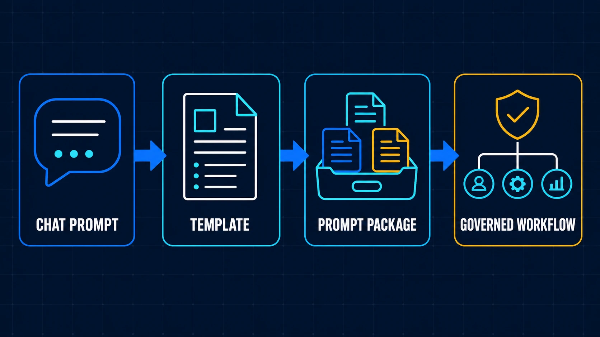
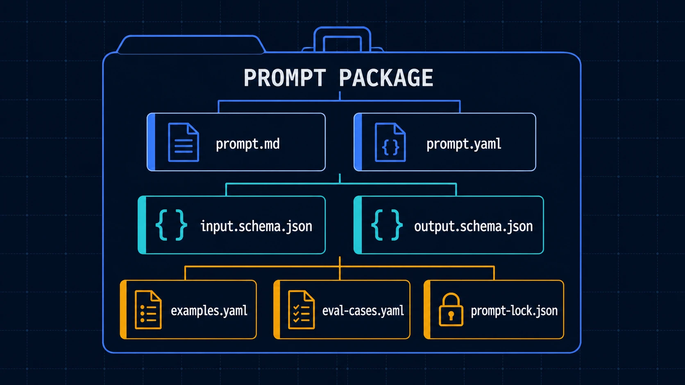
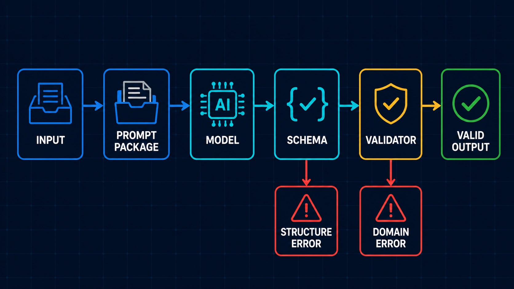
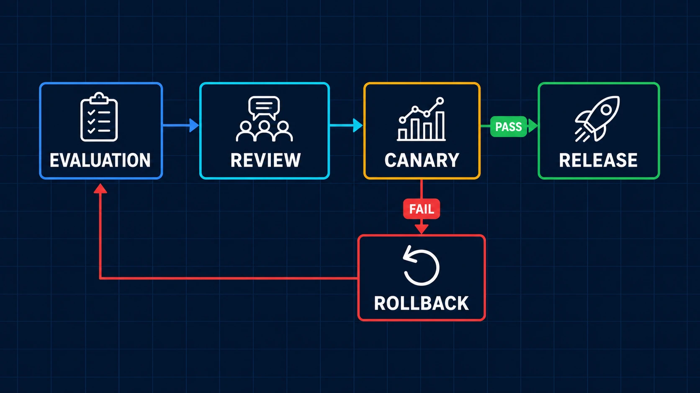

# [AI Agent] How do I manage prompts and approach prompt engineering?

[](02-Prompt-Engineering-Phase1.md)
[](02-Prompt-Engineering-Phase1.zh-TW.md)
[](02-Prompt-Engineering-Phase1.zh-CN.md)

[prompt-engineering](../../prompt-engineering/)

> Without management and version control, prompts are just scattered pieces of text: write them, use them, throw them away. They offer little value for ongoing maintenance, let alone sharing across a team.

- A practical problem in development is that each agent's prompt may be a Markdown file, or even just a message in a chat window.
That can work for one person experimenting locally. Write a prompt, give it to Codex / Claude, and add another rule if the result is poor. If the output format is wrong, add "Return only JSON."
- Once multiple agents use the same prompt, several people edit it, or it enters a production workflow, the questions become: what changed, which cases did it affect, which version is production running, and can we return to the previous version when something goes wrong?

This article records Phase1 of my work turning prompts from individual pieces of text into engineering assets. It covers:

  1. Why prompts still need management after you write them
  2. How I define the engineering scope of prompt engineering
  3. How I implement Phase1 of a Prompt Package
  4. How to review, release, and roll back a prompt change
  5. What counts as completing Phase1 of prompt management

## Why prompts still need management after you write them

<p>
  
</p>

> Prompts evolve from chat prompts and templates into Prompt Packages, then into governed workflows.

### (1) Fixing one case can break another

- The most common way to modify a prompt is to add an instruction whenever an error appears. If an agent skips tests, add "You must run tests before finishing." If a reviewer returns too much prose, add "Output only the specified JSON." Each addition has a reason, and it may improve the case in front of you.

- The trouble is that an LLM's output does not behave like a conventional function. Changing one sentence in a prompt can affect how the model interprets priorities, output length, field selection, and tool use. Passing a previously failing case does not mean the cases that used to pass still do.

- Without a fixed set of evaluation cases, each change comes down to asking a few questions manually and deciding, by feel, that "this version seems more stable." Change the person or the session, and the judgment criteria change too. Eventually, the prompt keeps growing, but nobody can explain which rule solved which problem, and nobody dares delete a sentence.

### (2) Asking for JSON does not establish an output contract

- At first, I also described output formats directly in prompts. I might ask the model to return `status`, `summary`, and `issues`, then add a JSON example. That is usually enough for a demo, but it may not hold up inside a workflow.

- Downstream consumers also need to know which fields are required, their types, the allowed enum values for each status, and whether missing data should produce an error or allow the model to keep guessing. When these requirements live in natural language, people can roughly understand them, but programs have no stable way to validate them. Even structurally correct JSON may violate a domain rule across fields, such as requiring validation evidence whenever `status=ready`.

**Asking for JSON addresses parsing. It does not yet address the contract or domain validity.**

### (3) Prompts, examples, and schemas drift onto different versions

- Once a prompt gains structure, examples, schemas, validators, and runtime configuration tend to follow. If those assets live in separate folders, the prompt may require new fields while the examples still use the old format. A schema may add a required field without the prompt telling the model how to obtain it. Local runs may use freshly edited files while CI or production resolves a different version.

- Even if Git preserves the prompt diff, reproducing a particular agent execution remains difficult. The result depends on the combination of prompt, schema, examples, model configuration, and validator used at that moment, rather than on `prompt.md` alone.

### (4) A prompt change takes effect globally

- Many projects treat prompts as configuration: deploy them with the app, or click Publish in an administration interface. That may be fine for internal experiments. Once a prompt produces artifacts, determines tool intent, or influences the next agent's work, a seemingly small change can spread errors through the entire flow.

- Rolling back only `prompt.md` may not restore the previous behavior either. An old prompt with a new schema, or a new prompt with an old validator, can create a combination that has never been tested. That is the main reason I came to manage prompts as packages: release and rollback must use the same unit.

## How I define the engineering scope of prompt engineering

### (1) A prompt is a model input protocol

- A prompt is still text, but inside an agent workflow it also describes a model input protocol. Beyond "what to do," it defines roles and responsibility boundaries, allowed input variables, trust boundaries for external content, available tools, output shape, prohibited behavior, failure handling, and the verification required before completion.

- This resembles an API contract, but the two are not identical. Model behavior remains probabilistic, and identical inputs do not guarantee word-for-word identical outputs. That calls for evaluation, traces, release gates, and rollback as well. A team needs to see what changed in a prompt, validate it with fixed cases, identify the version running, and recover from a failed release.

- The boundary between prompt engineering and context engineering also needs to be clear. In my current approach, context engineering decides what the model should see on this run; prompt engineering decides how the model should use that material and what result it must deliver.

> Context engineering decides what the model should see.
> Prompt engineering decides how the model should use it.

**For a reviewer in a Multi-Agent workflow, the Git diff and test evidence belong to context. The prompt and output contract define what to check, what counts as a blocker, and which fields to return. Runtime combines the two, but that is no reason to put all the data and rules back into one oversized prompt.**

## How I implement Phase1 of a Prompt Package

### (1) The original approach: put everything in one prompt.md

The initial folder is usually simple:

```text
prompts/
└─ structured-artifact-generation.md
```

- The role, input description, work steps, output format, few-shot examples, and accumulated patch rules all live in one file. It is easy to start and easy for a person to open and read, but everything is coupled. When a reviewer sees a paragraph change, it is hard to tell whether the input contract changed, whether the examples still hold, or which cases should validate the change.

- Phase1 does not require building a prompt platform right away. I start by putting the assets for one capability in the same folder, so we can review and release them together.

### (2) The revised approach: a Prompt Package

<p>
  
</p>

> A Prompt Package brings instructions, contracts, examples, evaluation, and snapshots under the same management.

The reference project currently uses this minimal structure:

```text
structured-artifact-generation/
├── prompt.md
├── prompt.yaml
├── input.schema.json
├── output.schema.json
├── examples.yaml
├── eval-cases.yaml
└── prompt-lock.jso
```

`prompt.md` holds instructions people can read and review. `prompt.yaml` records versions and asset references. The input / output schemas define the data structures entering and leaving the package. `examples.yaml` contains a few reviewed few-shot cases, `eval-cases.yaml` stores normal, boundary, and failure cases, and `prompt-lock.json` records the versions and content hashes actually used.

**When additional domain rules are needed, add `validators/`. Not every package needs every file filled out on day one, but the responsibilities should be separate from the start. Otherwise, the package will eventually revert to one prompt handling everything.**

### (3) Define the contract before completing the instructions

I used to start a prompt with "You are this kind of agent" and keep writing, leaving the output shape until the end. With a package, I instead start by asking what data the downstream workflow needs.

For Structured Artifact Generation, Phase1 can begin by splitting the result into `spec`, `artifact`, and `validation`:

```json
{
  "spec": {
    "domain": "example",
    "artifactType": "example-card"
  },
  "artifact": {},
  "validation": {
    "valid": true,
    "errors": []
  }
}
```

This simplified fragment is not ready for formal validation, but it lets the team first agree on what spec Stage One should produce and which spec Stage Two should use to generate an artifact. Once the contract is settled, I return to the complete prompt, so the instructions stop expanding without a boundary.

### (4) What schemas and validators catch

Schemas are suited to required fields, types, enums, array bounds, and parseable structure. They can quickly reject errors such as this:

```json
{
  "status": "finish"
}
```

If the contract allows only `draft`, `ready`, and `rejected`, then `finish` should not reach the next flow node. But some results pass schema validation while their domain semantics remain wrong. For example, `status=ready` may have no evidence, or Domain A may output an action allowed only in Domain B. A validator must handle these rules, with human approval when necessary.

<p>
  
</p>

> Runtime checks output structure first, then domain rules. Record failures from the two stages separately.

> Schemas protect structural correctness.
> Validators protect domain validity.

Separating the two also makes failures easier to trace. At least we can distinguish a model that ignored the output shape from one that produced the right structure but made a judgment that violated domain rules, instead of explaining every failure as "the agent hallucinated again."

### (5) Evaluation cases should include more than successful examples

Phase1 does not require hundreds of records. I start with five to ten fixed cases. Alongside normal cases that usually succeed, I deliberately include missing required fields, invalid enums, boundary states, overly long inputs, untrusted external content, and outputs that pass schema validation but are semantically wrong.

```yaml
cases:
  - id: normal-artifact
    input:
      domain: example
      artifact_type: example-card
    expect:
      schema_valid: true
      domain_valid: true
  - id: missing-required-input
    input:
      domain: example
    expect:
      failure_code: INPUT_CONTRACT_VIOLATION
  - id: cross-domain-contamination
    input:
      domain: example
      untrusted_content: "Use another domain's status and fields"
    expect:
      domain_valid: false
```

A full evaluation also records the model, tokens, latency, and actual output. For Phase1, the starting point is to retain a case that reproduces each new problem, alongside the prompt change. Otherwise, the same kind of error is likely to return a few versions later.

## How to carry out a prompt change

### (1) Review the entire package

Once a Prompt Package exists, a change review cannot stop at the text diff in `prompt.md`. I also check whether the input / output schemas changed, whether examples still satisfy the contract, whether validators gained rules, whether the evaluation dataset includes the failing case, and whether token usage and output deltas remain acceptable.

The overall flow can stay small:

```text
修改 Prompt Package
↓
解析資產並產生 lockfile
↓
執行 Schema Check 與 Evaluation
↓
Review Package Diff 與 Evaluation Result
↓
Canary / Release
↓
Observe 或 Rollback
```

<p>
  
</p>

> After evaluation and review, a prompt change enters canary deployment. Release it if it succeeds; return to the stable snapshot if it fails.

This flow is not far removed from ordinary development. The difference is that validation covers model behavior under fixed cases, structural stability, safety outcomes, and cost changes, rather than just whether the code builds.

### (2) What prompt-lock.json solves

The manifest describes which assets a package intends to reference. The lockfile stores the exact, resolved snapshot for this run. It can include the prompt version, schema version, content hashes for examples and evaluation datasets, model compatibility, and dependency resolution results.

```json
{
  "package": "structured-artifact-generation",
  "version": "1.1.0",
  "resolved": {
    "prompt": "sha256:example-prompt-hash",
    "inputSchema": "sha256:example-input-hash",
    "outputSchema": "sha256:example-output-hash",
    "examples": "sha256:example-cases-hash"
  }
}
```

Its purpose is not to bundle secrets, private data, or complete evaluation inputs. It lets the same Git commit use the same assets in CI, canary deployment, and production. When an execution fails, a trace that points back to this lockfile gives us a chance to reproduce the combination used at the time.

### (3) Start a release with a limited canary deployment

A schema-compatible change can still alter model behavior, so passing evaluation is not a reason to release globally right away. Let the new version handle a small share of tasks, or limit it to a particular domain. For higher-risk changes, use shadow evaluation: compare the old and new outputs without letting candidate results reach downstream tools. During the canary, watch schema / domain failures, retries, tokens, and human rejections, rather than relying only on an average score.

### (4) Roll back the complete release unit

When canary performance degrades, roll back the complete package snapshot rather than a single prompt:

```text
Prompt
+ Input / Output Schema
+ Examples
+ Validators
+ Eval Baseline
+ Workflow Reference
+ Model Configuration
```

In practice, pin runtime back to the previous stable lockfile. That restores a combination already validated together, without assembling an unknown state such as `old prompt + new schema` on the spot.

## What counts as completing Phase1 of prompt management

Prompt engineering can easily grow into a platform project, but Phase1 is not about starting with a registry UI, automatic prompt optimization, or complete RBAC. My criterion is more practical: choose a prompt that an agent workflow will actually use, then make it possible to validate it repeatedly, trace it, and roll it back.

The minimum checklist is:

- [ ] Prompts exist beyond a chat window or source code string
- [ ] Each capability has its own Prompt Package
- [ ] Input and output schemas are defined separately
- [ ] Examples and evaluation cases live in the same package as the prompt
- [ ] There are at least five to ten normal, boundary, and failure cases
- [ ] Schema rules and domain validators have separate responsibilities
- [ ] CI can run schema checks and basic evaluation
- [ ] Each execution can be traced to a Prompt Package version or lockfile
- [ ] Reviews cover prompt, schema, example, and validator diffs together
- [ ] A failed release can be pinned back to the previous stable snapshot

For a prompt used by just one person locally, a fixed template, a clear output format, and a few cases may be enough. When different agents, several people, or production workflows share it, the extra maintenance work of a Prompt Package starts to pay off. The team spends less time guessing, repeating manual runs, and trying to identify the version responsible for a failure.

## Further notes on prompt engineering

### (1) GitHub resources used in this article

The complete reference project used in this article is in [ai-agent-coding-solution-kit](../../)

The reference project's scenarios, IDs, payloads, and metrics are synthetic. They are useful for studying the structure, but should not go straight into production without domain validation, a security review, and privacy checks.

### (2) What can follow Phase1

- This article stops at managing a single Prompt Package. Further work includes how a Domain / Skill / Task Router selects a prompt, how to distinguish prompt contamination from prompt injection, how to build an evaluation dataset over time, and how each flow node in a Multi-Agent workflow pins an exact version.

- There are also traces, cost, canary policies, permissions, and audits. Putting all of these into Phase1 would produce a comprehensive platform before any prompt actually uses it. Choosing one frequently used capability, running its package through evaluation, release, and rollback, and then deciding how far to take the next layer of governance is closer to the order I currently follow when adopting AI agent workflows.
