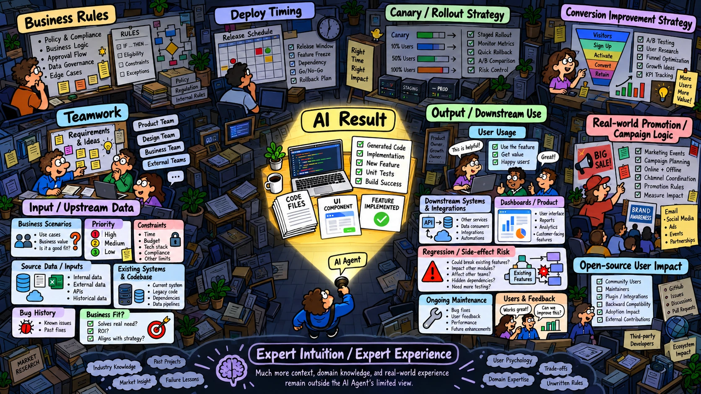
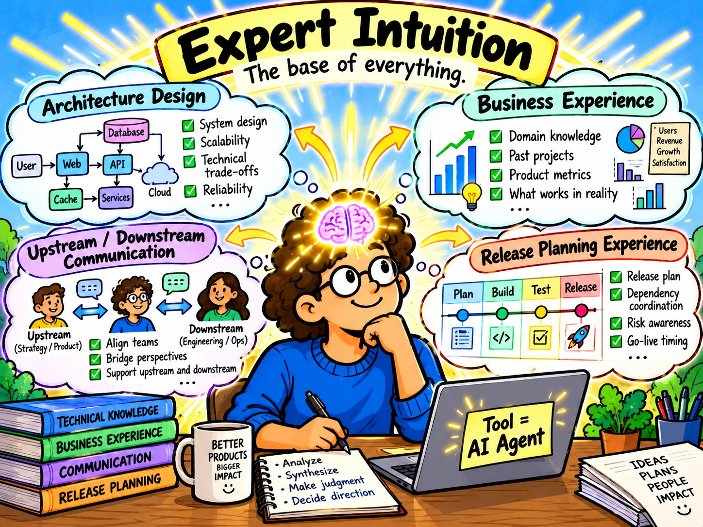

# [Development] AI 时代最需要的能力是专家直觉（Expert Intuition）

[English](./01-Development-AI-Era-Expert-Intuition.md) | [繁體中文](./01-Development-AI-時代最需要的能力是專家直覺.md)

我想使用 AI 的人会特别有感，AI 能更高效地完成大量重复劳动，甚至具备一定的推理和猜测能力，可以帮人类完成一部分具有“创造和模仿”性质的工作。这也让过去被认为重要的“快速完成产出”变得没那么重要，而真正能让业务落地，或者说完整地“把现状拉向期望”的软实力，重要性正在上升。

而我认为，软实力的基础是“专家直觉”，原因是 AI 的产物最终都要进入人类的世界，为 AI 产出负责的人、购买意愿、使用评价都来自人类。所以，AI 当前更像是生产过程的加速器，它让能推动完整落地的软实力更快被看见。后续我会以软件工程为例，其他行业的朋友可以自行对应到自己的领域。

### 专家直觉是什么？

对专家直觉（Expert Intuition）这个词陌生的人，可以查看以下学术定义

1. [Conditions for intuitive expertise: A failure to disagree.](https://psycnet.apa.org/record/2009-13007-001)
2. [Dan Kahneman and Gary Klein on strategic decisions: When can you trust your gut?](https://bobmorris.biz/dan-kahneman-and-gary-klein-on-strategic-decisions-when-can-you-trust-your-gut)

本篇不会展开术语的学术讨论，只会对真实的“软件工程进入业务场景时所需的专家直觉”做初步说明，先看以下这张图

AI Expert Intuition

要完成一项软件开发并落地到业务场景，Coding 只是其中一部分（图中手电筒照亮的区域）。更完整的工作还需要架构设计、错误定位、方案取舍、上下游对接、发布标准、版本控制、转化分析（图中光亮以外的部分），以及各种商业需求带来的长期演进、协作、Schedule、策略、评估、盈利，更不用说对业务灰色规则的理解。这些是目前 AI 无法完成的，却恰恰是软件在人类世界中产生收益的来源。

### 我所认为的“专家直觉”

在软件工程中，所谓的专家直觉，是能满足“完整业务落地”的能力，我拆分为：

> ***软件工程的专家直觉 = 架构设计 + 业务经验***

#### 架构设计

现实的开发任务没有标准答案，软件开发会随着 User 人数、目标群体、时间紧迫性，以及跨国、地区、信仰文化等因素调整，所以真正的专家要能做到

1. **方案取舍**：说出架构设计方案为什么“选 A，而不选 B、C、D、E”，是否有适用的设计模式，而不是半年后回来看时，人类已经难以维护，只能被迫陷入 ACA (AI Check AI) 的开发地狱。
2. **错误定位**：当 AI 给出表面合理但错误的理解、Code 耦合冗余，种种问题导致无法运行时，你要能发现并解决。例如，最经典的问题是“我这手机能正常跑啊，但为什么别人的不能”。毕竟在真实情况下，你不能把每个 User 的手机都拿过来给 AI 跑一次检查。如果是线上问题，修复时间会更紧迫，每多故障一分钟就会有更多损失。AI 不会为损失负责，负责的是你本人。
3. **问题边界**：现阶段的 AI 处于一种状态：你没提到、你没问，AI 默认就不会回答，除非它有非常高的关联性，出现在 Retriever 分析的 Top K 中，才可能被提到。然而，现实的 Bug 往往由少数场景引发。例如，开发 WeChat Miniapp 时，Request Head 的长度限制是 <= 1024 Byte，当 Head 扩充后超过该长度限制，就会 Request Fail。不了解这个边界问题的人，纯粹使用 AI 开发并发布，将导致灾难。
4. **问题定位**：真实开发中经常需要提升 Performance，但提升的手段到底应该面向哪个目标 User 群体？哪一个指标？要针对老旧机型的 User，还是其他群体？提升 Performance 的 TTFT / LCP / QPS 等指标，与业务的 DAU、MAU 有哪些关联？如何下手才能提高转化率？AI 现在做不到把这些东西很自然地连在一起。哪怕它给出数字，也只是一个有局限，甚至是随意猜测的值。

#### 业务经验

软件进入业务领域、变成开发任务后，核心还是围绕实际场景，特别是上下游对接、发布时间、配合活动、历史灾难事件

1. **上下游对接**：成熟的大型 App 不只有一个团队在开发，往往是多团队共同开发。再者，完成某个流程会依赖数十个、甚至上百个 Key / Value。如何辨别当前开发的功能取用哪个 Value 能完成任务，哪个 Value 修改后对自身团队没有影响，却会引发上下游团队的问题？每个团队对 Code 的管理都有权限限制，无法随意让外部 AI 读取。哪怕对方给你权限，那它还有上下游呢？
2. **发布时间**：这个需求发布到真实世界时，会处于什么场景？最简单的，譬如圣诞节、黑色星期五，能不能赶上真实世界中人类行为的购买预期，让业务收益提升？
3. **历史灾难事件**：避免过去发生过的相似修改再次导致灾难。例如，活动引流使用户数量骤增时，不会出现 APP 崩溃、Server Overload、重复操作、重复订单等问题。或者，作为 Open Source 的提供方，你做了修改，却给使用 Tool 的下游团队带来灾难，例如曾经发生的 [Ant-design 圣诞节彩蛋灾难](https://github.com/ant-design/ant-design/issues/13848)。

### 专家直觉再精进：把现状拉向期望的能力

AI 时代真正稀缺的软实力，再往下精进，我拆分为：

> ***把现状拉向期望的能力 = 专家直觉 + 无权领导力***

#### 无权领导力

不管在职场还是 Open Source 社区，协作都需要大量沟通，并非每次都有直接的指挥权。如何与外部成员讨论方案、提高执行意愿，也是 AI 无法替人补足，却真实存在的一环

1. **协作团队的意愿**：AI 时代，人类的时间和注意力是很稀缺的资源，上下游团队有他们自己的需求 Priority 和任务 Schedule。哪怕 AI 可以快速完成 Code 的产出，你也要让对方愿意花时间和你沟通。所以，让自己的需求排进对方的 Schedule，并提高 Priority，让对方的执行意愿和配合度增加，是很重要的事，因为 AI 无法帮你说服同事。
2. **依赖成本的厘清**：在前述多团队协作的场景下，完成你的任务会有一条依赖路径，例如：你的任务 ➔ 团队 A ➔ 团队 B ➔ 团队 C。只要其中一个环节延迟或出错，就无法如期完成任务。这考验的是你如何把多方协作的产物、契约都约定正确，并让各方知道自己处于哪个环节，以及进度落后会有多大影响。AI 当然无法帮你完成这方面的任务。

### 结论：专家直觉在 AI 时代比过去更重要

身处 AI 爆炸性增长的时代，人人都在问、都在思考如何减少 Token 消耗、降低成本、减少人类时间的消耗。但也该适当地停下来反问：有没有一种能力，让你不通过 AI、不消耗 Token、不浪费等待 AI 回复的时间，就已经能发现真实业务场景中的问题，并在短时间内给出解决方案？不要耗费了所有成本之后，才发现原来有问题存在、方向根本被 AI 带偏了，或者受制于外部因素而无法如期完工。

期望每个有专业能力的工作者，都同时具备三个能力：

1. 有精准使用 AI 的基础能力
2. 有专家直觉来判断 AI 的产出是否正确
3. 有把现状拉向期望的软实力

具备以上 AI 时代最稀缺的能力，才能避免快速用 AI 完成了表面产出，却发现它与真实需求不符，也无法让人类安心使用。甚至出了问题，人类想修正却找不到切入点，最后只能陷入 ACA (AI Check AI) 的恶性循环。
