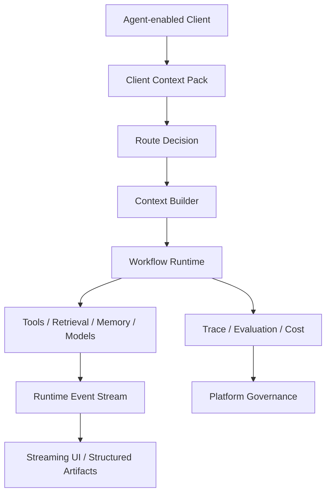

# AI Agent 上下文工程

[](./README.md)
[](./README-zh-TW.md)
[](./README-zh-CN.md)

一套以 TypeScript 为优先、用于选择、组装、传递、评估与治理 AI Agent 上下文的参考架构。

本工程把 Context 视为 Runtime 系统，连接 Context Route、渐进式披露、RAG、Memory、Tool、多模态资产、终端事件、工作流执行、可观测性与平台治理。

> 本仓库记录的是参考架构。  
> 所有场景、标识符、指标与 Payload 均为合成示例。  
> 真正导入生产环境前，仍需完成领域验证、安全审查、评估与运营控制。

## 本工程涵盖什么

整套文件主要回答三个问题：

1. 模型在每一个推理步骤中应该看见什么？
2. 终端应如何承接、展示、取消、恢复与修复一次 Agent Run？
3. 多个 Agent、Tool、Prompt、Workflow、Memory Policy、Schema 与 Eval 应如何被统一治理？



## 文件导览

1. [上下文工程核心](./docs/01-context-engineering-core-zh-TW.md)  
   说明 Context 数据源、权威性、Route、渐进式披露、RAG、Memory、Tool Context、多模态、Token 治理与评估。

2. [Agent 终端与工作流 Runtime](./docs/02-agent-client-runtime-zh-TW.md)  
   说明 Client Context Pack、Runtime Event、Streaming State、工作流执行、Tool 生命周期、Structured Artifact、取消、重试、恢复与最小可运行纵向链路。

3. [Agent 平台运营与治理](./docs/03-agent-platform-operations-zh-TW.md)  
   说明 ContextOps、Registry、Observability、Eval Dataset、成本控制、权限、发布、回滚与成熟度模型。

辅助区域：

- [Patterns](./patterns/README-zh-CN.md)
- [Templates](./templates/README-zh-CN.md)

## 核心原则

```text
先 Route，再組裝。
先摘要，再展開。
優先使用最小但足夠的 Context。
精確狀態使用結構化資料。
非結構化知識使用 Retrieval。
即時狀態使用 Tool 或 Database。
Memory 應拆成多種 Store，避免收斂成單一 Vector Database。
模型負責理解與解釋，不負責臆造營運事實。
終端應承接 Runtime Event，並將文字 Token 視為其中一種輸出。
所有策略都必須可觀測、可評估、可發布、可回滾。
```

## 参考场景

| 场景 | 用来说明 |
|---|---|
| 知识助手 | Retrieval、Rerank、Evidence、Citation、Faithfulness |
| 即时状态助手 | Read-only Tool、来源权威性、结构化状态 Artifact |
| 支持工作流 | 多轮状态、Memory、资格检查、审批、Fallback |
| 多模态助手 | Asset Context、OCR / ASR / Vision、信心分数、澄清 |
| 开发者助手 | Repository Context、Tool 选择、Patch Artifact、验证 |

## 范围

- Context 数据源选择与组装
- Route Policy 与渐进式披露
- Retrieval 与 Hybrid Memory
- Tool Context 与输出裁剪
- 多模态 Asset Context
- 终端 Context 采集
- Runtime Event Protocol
- Workflow State 与恢复
- Structured Artifact Rendering
- Trace、Eval、成本、发布与治理

## 非目标

本工程不是：

- 可直接上线的托管平台
- 领域权限系统的替代品
- 模型输出正确性的保证
- 所有 Runtime 与 Registry 的完整实现
- 未经审查就把私有数据送入模型的理由
- 安全、隐私、法务与可靠性控制的替代品

## 建议模块结构

```text
context-engineering/
├─ README.md
├─ README-zh-TW.md
├─ docs/
│  ├─ 01-context-engineering-core.md
│  ├─ 01-context-engineering-core-zh-TW.md
│  ├─ 02-agent-client-runtime.md
│  ├─ 02-agent-client-runtime-zh-TW.md
│  ├─ 03-agent-platform-operations.md
│  └─ 03-agent-platform-operations-zh-TW.md
├─ patterns/
│  ├─ README.md
│  └─ README-zh-TW.md
└─ templates/
   ├─ README.md
   └─ README-zh-TW.md
```

## 阅读路径

```text
README
→ Context Routing
→ Progressive Disclosure
→ Client Context Pack
→ Runtime Event Protocol
→ Observability
```

文件使用 TypeScript Contract 与 Mermaid 表达架构与边界。实际使用时，应依模型供应商、工作流引擎、终端框架、存储层与安全模型调整。
