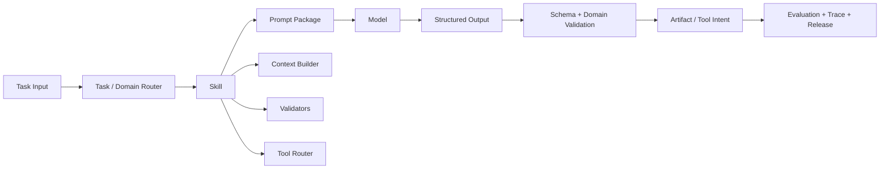

# AI Agent Prompt Engineering

[](./README.md)
[](./README-zh-TW.md)
[](./README-zh-CN.md)

这是一套可重用的 Prompt Engineering 参考工程，用来把提示词文字整理成可版本化、可评估、可发布、可观测、可回滚的工程资产。

> 本工程记录的是参考架构。
> 所有情境、标识符、payload、示例与指标都是合成数据。
> 导入生产环境前，仍需完成领域验证、安全审查、评估、隐私控管与运营防护。

## 本工程涵盖什么

本工程把 Prompt 视为**模型输入协议**，而不是孤立的提示词文案，并连接：

- Domain 与 Skill 边界；
- Prompt Package 与结构化契约；
- Prompt 污染预防；
- Prompt Injection 防护；
- 离线资产治理；
- 在线 workflow 执行；
- 评估、成本、跟踪、canary release 与 rollback；
- YAML manifest 与可重现的 `prompt-lock.json` 快照。



## 核心原则

```text
1. 把 Prompt 當成協議，而不是散文。
2. 讓 Domain 負責語意邊界。
3. 讓 Skill 負責工程邊界。
4. 先 routing，再組裝 context。
5. 先產生結構化 spec，再產生最終 artifact。
6. 用 schema 保護結構，用 validator 保護領域語意。
7. 區分 Prompt 污染與 Prompt Injection。
8. 讓工程師操作 workflow 與 skill，不直接操作未受控的正式 Prompt。
9. 讓每個 Prompt Package 都可評估、可發布、可觀測、可回復。
```

## 文件地图

1. [Prompt Engineering 系统](./docs/01-prompt-engineering-system-zh-TW.md)  
   完整参考架构，涵盖 Prompt Package、Domain、Skill、routing、workflow、评估、版本、lockfile、release 与 rollback。

2. [English: Prompt Engineering System](./docs/01-prompt-engineering-system.md)

## 可重用模板

| 文件 | 用途 |
|---|---|
| [`prompt-manifest.example.yaml`](./templates/prompt-manifest.example.yaml) | 宣告 Prompt Package 与它的契约、政策、示例、评估案例与 validator。 |
| [`workflow.example.yaml`](./templates/workflow.example.yaml) | 宣告离线与 runtime workflow，不把业务逻辑塞进 YAML。 |
| [`domain-registry.example.yaml`](./templates/domain-registry.example.yaml) | 将稳定 domain 对应到 skill、state enum、禁用值、validator 与风险等级。 |
| [`prompt-lock.example.json`](./templates/prompt-lock.example.json) | 示范可重现评估与发布用的 dependency snapshot。 |

## 完整 Prompt Package 示例

[`prompts/structured-artifact-generation/`](./prompts/structured-artifact-generation/) 内含一个完整的合成 Prompt Package：

```text
structured-artifact-generation/
├── prompt.md
├── prompt-zh-TW.md
├── prompt.yaml
├── input.schema.json
├── output.schema.json
├── examples.yaml
├── eval-cases.yaml
└── prompt-lock.json
```

这个 package 实现一个合成 domain：`offer_card`。它的负面评估案例会刻意注入另一个 `entitlement_card` domain 的 state 与 action，用来示范 domain isolation 与 contamination detection，但不会把两个 domain 放进同一个正式 Prompt Package。

## 建议阅读顺序

```text
README
-> Prompt 作為模型輸入協議
-> Prompt Package
-> Domain / Skill / Router 邊界
-> 離線治理
-> Runtime Workflow
-> 評估與成本
-> YAML Manifest 與 Lockfile
-> Canary 與 Rollback
```

## 如何导入

1. 将 `prompt-engineering/` 复制到 repository root。
2. 先阅读系统文件，再重用模板。
3. 以合成 Prompt Package 作为起点。
4. 将 domain、schema、example 与 validator 换成经审查的项目资产。
5. 实现或接上一个能理解 YAML node type 的 runner。
6. 在 CI 产生 lockfile，不要手动编辑。
7. 正式使用前加入 evaluation gate 与 release gate。

## 范围

本工程涵盖：

- Prompt Package 结构；
- Domain 与 Skill isolation；
- 结构化 input / output contract；
- 两阶段 artifact generation；
- 工程团队使用的 workflow governance；
- Prompt contamination 与 Prompt Injection；
- token 与质量评估；
- SemVer、manifest、lockfile、canary 与 rollback 实务。

## 非目标

本工程不是：

- 可直接上线的 hosted prompt platform；
- 完整 workflow runner；
- domain authorization 的替代品；
- 模型输出正确性的保证；
- 让 secret 或 private data 暴露给模型的理由；
- 安全、隐私、法务与可靠性控管的替代方案。

## 授权与调整

这些文件设计成可复制、可调整。请让合成示例与正式数据保持清楚分离，并在目标环境中验证每个 schema、policy、model、tool 与 release process。
